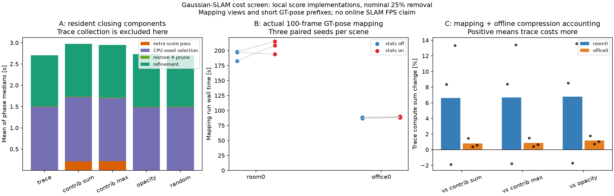
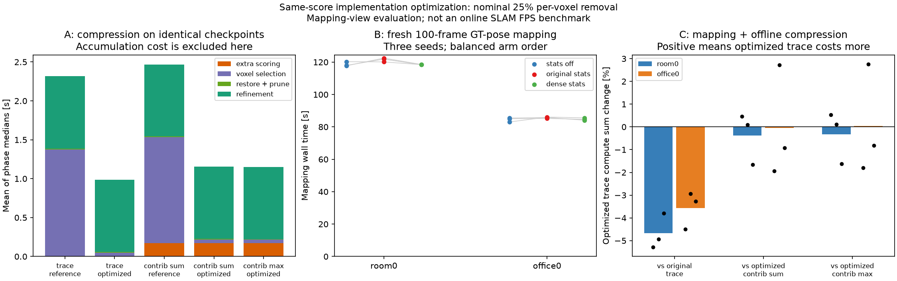

# Follow-up: separating score quality from implementation cost

This page extends [the original report](REPORT.md). Experiments below use different scenes, seeds and controls;
their quality/time numbers must not be pooled. Original negative results and decision thresholds remain visible.
The dated plans and raw logs are retained locally; the public metrics do not establish independent prior registration.

## 1. Match actual turnover before attributing a quality gain

The original Taming-growth/trace-pruning comparison was +0.056 dB against Taming, but replaced about 1.8 times as
many Gaussians. A matched-turnover test held the growth rule and actual deletions at each event fixed. On two
existing scenes × two seeds × two deletion scores (eight 30,000-iteration runs), trace was **+0.0741 dB**, with
4/4 positive pairs and mean LPIPS −0.000682. This did not meet the fixed +0.10 dB mean-PSNR adoption threshold; the rule also required at least 3/4
positive pairs, positive means in both scenes, mean LPIPS change ≤+0.002, and correctness checks.

Candidate shortages required a common growth-threshold relaxation. One previously completed bonsai pair was
reused only after verifying that this fallback was never needed there. The result describes the amended common
growth rule, not unchanged upstream Taming, and does not fully explain the original gain. See
[all eight runs and decision checks](results/followups/matched_turnover.json).

## 2. A small improvement still has to face the gradient control

A single soft-trace candidate was fixed before the next screen: positive-median-normalized trace plus 0.1,
used in inverse deletion sampling. Five scores were trained on each of bonsai/kitchen at a fresh seed 3,
sharing the same growth rule and the historical Taming seed-1 deletion schedule. All ten conditions completed
30,000 iterations. Historical metrics were not pooled with the fresh environment.

Soft trace gained **+0.0740 dB** over trace, while LPIPS worsened by +0.000440. It remained **−0.1037 dB** behind
the gradient deletion control; original trace was −0.1777 dB behind gradient. Gradient had the highest PSNR in
both scenes. The fresh screen allowed a small gain: advancement required mean PSNR strictly above each of Taming, gradient
and random, with mean LPIPS change ≤+0.002 against each. Neither trace candidate passed, so the conditional
six-run seed-4 extension was not run. The offset was not retuned. One bonsai view accounts for much of the gain over Taming; the per-view values and the diagnostic
excluding that view are retained, without replacing the primary result.

This gradient control changes **deletion only under common Taming growth**. It differs from the original
report's gradient arm, which changes both growth and deletion. See [all ten runs and per-view metrics](results/followups/trace_development.json).

## 3. Render-free scoring does not mean zero collection cost

The first cost experiment compared locally implemented trace, contribution-sum/max, opacity and random under
the same 5 cm voxel quotas and nominal 25% removal. It used three scenes × three saved submaps, one warmup and
five measured repetitions per arm, with frozen colours and 50 optimizer steps. Repetitions are timing repeats,
not five independent training seeds. The extra contribution pass requests colour gradients only.

With statistics already present, trace closing was **7.89% faster than contribution-sum** and **8.23% faster
than contribution-max** (ratios of sums of nine map-level medians). Mean per-submap closing time was 2.734 s
versus 2.968/2.979 s. This phase includes scoring, selection, restore/prune and refinement; it excludes earlier
statistics collection, common load, evaluation and serialization. Trace's CPU selection consumed roughly 55%
of its closing compute time.

Collection was then measured in actual 100-frame GT-pose mapping, two scenes × three seeds × stats on/off.
The mean paired mapping-wall changes were **+7.04% in room0 and +1.21% in office0**. Including mapping, common
load and later compression, trace cost **6.59% / 0.81% more than contribution-sum**, respectively. This is a
selected cost sum, not end-to-end CLI wall time or online SLAM FPS. Native mapping wall includes its original
source-checkpoint writes, data reads and logging; it is not pure GPU compute or a FLOP count. Compressed-output
serialization and compression evaluation are excluded. Same-seed CUDA geometry and timing still
vary. Thus the original local implementation did not demonstrate a net cost advantage.

See [phase records, all native runs and seed-level comparisons](results/followups/slam_score_cost.json).

## 4. Optimize the same computation before changing the method

The implementation experiment keeps every-step statistics, score formula, CPU float32 voxel assignment,
per-voxel quotas and original-index tie breaking. Dense `torch.where` updates avoid variable-length Boolean
gathers. Collision-free packed voxel keys and stable CUDA sorts replace repeated CPU voxel grouping. Overflow
falls back to coordinate sorting. The optimized selector is applied to contribution and opacity controls too.

Development validation used 63 real gradient packets from the nine source submaps: accepted dense buffers
matched the original function bit for bit. Dedicated GPU edge checks cover 96 collector and 26 selector cases.
Both selector backends matched all 45 real score/submap masks. A single-kernel Triton collector failed exactness
because reduction rounding differed and was rejected. A first profiler attempt was excluded after correcting an
unnecessary allocation in its shape-only proxy; the corrected development run selected one global CUDA backend.
No scene-specific backend choice or lower collection frequency was used.

The final frozen comparison reruns both original and optimized compression on all nine sources, then compares
stats-off/original/dense mapping on two 100-frame GT-pose prefixes × three seeds. Arm order is rotated across
seeds. Each source has its own refine-only control. Absolute timings from the previous cost run are not used as this
experiment's reference: both original and optimized implementations are measured fresh. Same-input optimized masks are checked against the original
CPU oracle outside the timed phases. Equal masks do not imply bit-identical CUDA refinement or trajectories.

### Frozen comparison results

Closing time is the sum of nine map-level medians (one warmup excluded, five measured repeats).
Earlier statistics collection, load, validation, evaluation and serialization are excluded.

| Implementation | Closing total [s] | Optimized trace change against this arm |
|---|---:|---:|
| Original trace | 20.850468 | -57.44% |
| Optimized trace | 8.874015 | +0.00% |
| Original contribution-sum | 22.268848 | -60.15% |
| Optimized contribution-sum | 10.377644 | -14.49% |
| Optimized contribution-max | 10.338910 | -14.17% |
| Optimized opacity | 8.772671 | +1.16% |

All 264 deferred same-input selection checks matched the original CPU mask. Dense collector exactness concerns identical input streams, not independent native mapping trajectories.

The 18 fresh native mapping runs retained the same optimizer-step counts within each scene–seed block. Mean paired changes below are percentages per seed, averaged within each scene; all seeds remain in the JSON.

| Scene | Dense vs original mapping | Dense vs stats-off mapping |
|---|---:|---:|
| room0 | -2.48% | -0.16% |
| office0 | -1.03% | +0.37% |

Mapping + compression is mapping run wall + common load/prepare + closing compute. It excludes deferred validation, compression evaluation/import and compressed-output serialization. Native mapping wall still includes source checkpoint writes, data loading and logging; this is not pure GPU compute, end-to-end CLI wall time or online FPS.

| Scene | vs original trace | vs optimized contribution-sum | vs optimized contribution-max |
|---|---:|---:|---:|
| room0 | -4.67% | -0.37% | -0.33% |
| office0 | -3.57% | -0.05% | +0.05% |

| Scene | Seed | Optimized trace total [s] | Optimized contribution-sum total [s] | Change |
|---|---:|---:|---:|---:|
| room0 | 0 | 122.5591 | 122.0055 | +0.454% |
| room0 | 1 | 122.4033 | 122.2915 | +0.091% |
| room0 | 2 | 122.5383 | 124.6144 | -1.666% |
| office0 | 0 | 86.3608 | 88.0636 | -1.934% |
| office0 | 1 | 87.8029 | 85.4804 | +2.717% |
| office0 | 2 | 86.8040 | 87.6116 | -0.922% |

Trace totals are lower in 3/6 scene–seed pairs; the sign varies. Small mean changes do not establish a robust total-cost advantage. Statistics-off mapping also varies between independent runs, so a near-zero or negative observed overhead does not make collection free.

Positive percentages mean optimized trace costs more. Differences on these short prefixes are descriptive and include numerical variation in independent source maps. A phase-specific speedup alone does not establish a general system-level advantage.

### Quality and uncertainty

The table reports optimized trace minus each control on the identical historical sources. Fixed guards are PSNR ≥−0.10 dB, LPIPS ≤+0.002 and depth L1 ≤+0.1 mm; they are not equivalence tests.

| Scene | Control | ΔPSNR [dB] | ΔLPIPS | Δdepth [mm] | All guards |
|---|---|---:|---:|---:|---|
| room0 | Original trace | -0.000188 | +0.000000 | +0.000025 | True |
| room0 | Optimized contribution-sum | +0.038643 | -0.001383 | +0.069389 | True |
| room0 | Optimized contribution-max | +0.029880 | -0.001429 | +0.079738 | True |
| room0 | Optimized opacity | +0.524743 | -0.001268 | -0.142058 | True |
| office0 | Original trace | -0.000114 | +0.000002 | +0.000049 | True |
| office0 | Optimized contribution-sum | +0.014078 | -0.000673 | -0.032069 | True |
| office0 | Optimized contribution-max | +0.003998 | -0.000689 | -0.020254 | True |
| office0 | Optimized opacity | +0.995319 | -0.003601 | -0.295791 | True |
| room1 | Original trace | -0.000143 | +0.000007 | -0.000028 | True |
| room1 | Optimized contribution-sum | +0.046209 | -0.000878 | +0.030928 | True |
| room1 | Optimized contribution-max | +0.029063 | -0.000851 | +0.038177 | True |
| room1 | Optimized opacity | +0.405874 | -0.001928 | -0.098562 | True |

Independent native sources can differ even at the same seed. For prefix comparisons, the JSON retains both direct quality deltas and differences in loss relative to each source's own refine-only control. The following table summarizes the mean direct deltas across the three seeds.

| Scene | Control | ΔPSNR [dB] | ΔLPIPS | Δdepth [mm] | Seed pairs within all direct guards |
|---|---|---:|---:|---:|---:|
| room0 | Original trace | +0.004642 | +0.000041 | -0.000405 | 3/3 |
| room0 | Optimized contribution-sum | +0.055222 | -0.001605 | +0.023107 | 3/3 |
| room0 | Optimized contribution-max | +0.039720 | -0.001563 | +0.029248 | 3/3 |
| room0 | Optimized opacity | +0.439011 | -0.000627 | -0.100811 | 3/3 |
| office0 | Original trace | +0.008221 | -0.000032 | -0.266795 | 3/3 |
| office0 | Optimized contribution-sum | -0.045645 | -0.000809 | -0.174929 | 3/3 |
| office0 | Optimized contribution-max | -0.061400 | -0.000837 | -0.147908 | 2/3 |
| office0 | Optimized opacity | +0.738761 | -0.003886 | -0.368253 | 3/3 |

Direct prefix quality guards fail in 1/24 comparisons. A near-boundary miss remains a failure.
- office0, seed 1, against Optimized contribution-max: ΔPSNR -0.101133 dB, ΔLPIPS -0.000539, Δdepth -0.168619 mm.

Across the nine fixed-source cases, the maximum measured compression peak allocated memory was 1126.50 MiB for original trace and 1127.64 MiB for optimized trace. The new selector uses temporary GPU sorting buffers; these observations are not a VRAM-saving result. Per-case peaks and stored accumulator bytes remain in the JSON.

[All measured timings and quality](results/followups/slam_implementation.json) · [Independent code and contracts](code/README.md).

## What would make further work worthwhile?

A measured closing-latency constraint could justify integrating the optimized selection into an online system.
If the application already needs these exact statistics for another purpose, their collection can be common
cost; it is not common cost merely because training computes the underlying gradients. Many views can make a
fresh contribution pass more expensive, but larger maps alone do not guarantee a net gain. Contribution scores
can also be cached for repeated decisions on an unchanged map.

No tested online workload has demonstrated improved SLAM throughput from trace pruning. Before extending this
work, identify that workload and measure held-out quality, tracking and total cost against optimized controls.
The present artifact closes with measured engineering changes and bounded score comparisons.
