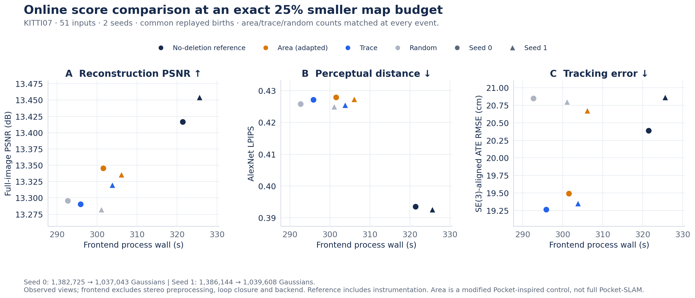

# Online score comparison at an exact 25% smaller map budget

**This is an adapted Pocket-inspired score ablation, not unchanged Pocket-SLAM or a full paper reproduction.**

KITTI07 original frames 0–100, stride 2 (51 inputs), seeds 0 and 1, RTX 5070 Ti. Each score arm retains exactly floor(0.75 × its common reference count) after frame 0. Saved NPZ counts, birth counts and actual deletions at every event agree across area/trace/random.

Native opacity deletion is disabled in all four arms. The no-deletion reference records birth pixels; the three score arms replay those same RGB-D observations using their own estimated poses. Exact capacity-capped tile quotas replace Pocket clipping, using its gradient-budget weights. Thus growth and quota rules are controlled adaptations.

All arms use native 1226×370 calibration, configured 100 tracking / 100 mapping iterations, a two-keyframe
mapping window, and mapping/keyframe insertion every input. The native tracking termination policy remains active.
Gaussians are isotropic with direct RGB; native mapping trains colours with RGB/depth loss weights 0.5/1.0.
There is no additional post-prune refinement. Trace resets at each mapping optimizer initialization and averages
squared position plus scalar log-scale gradients over visible mapping iterations.

| Seed | Arm | Gaussians | Frontend wall(s) | PSNR↑ | SSIM↑ | LPIPS↓ | ATE RMSE(cm)↓ | Peak allocated(GiB) |
|---|---|---:|---:|---:|---:|---:|---:|---:|
| 0 | baseline | 1,382,725 | 321.42 | 13.4168 | 0.60054 | 0.39355 | 20.388 | 4.185 |
| 0 | area | 1,037,043 | 301.50 | 13.3455 | 0.59069 | 0.42789 | 19.493 | 4.083 |
| 0 | trace | 1,037,043 | 295.86 | 13.2905 | 0.58932 | 0.42712 | 19.265 | 4.087 |
| 0 | random | 1,037,043 | 292.65 | 13.2957 | 0.58851 | 0.42579 | 20.848 | 4.082 |
| 1 | baseline | 1,386,144 | 325.58 | 13.4542 | 0.60400 | 0.39263 | 20.864 | 4.187 |
| 1 | area | 1,039,608 | 306.08 | 13.3356 | 0.59076 | 0.42730 | 20.673 | 4.079 |
| 1 | trace | 1,039,608 | 303.79 | 13.3198 | 0.58935 | 0.42545 | 19.351 | 4.087 |
| 1 | random | 1,039,608 | 301.03 | 13.2823 | 0.59025 | 0.42497 | 20.799 | 4.083 |

## Measured summary

At the same 25% smaller online point budget, **area, trace and random produced close image-quality metrics**: the PSNR ranges across the three scores were **0.055 / 0.053 dB**, and the LPIPS ranges were **0.00209 / 0.00233** (seeds 0 / 1). Trace showed no clear additional image-quality benefit in this screen. These descriptive ranges do not establish statistical equivalence.

Shared spatial allocation and continued mapping optimization may have reduced score differences. Their contributions were not isolated: no spatial-allocation-off or subsequent-mapping-off control was run. This result therefore does not establish that spatial budgets matter more than the score.

In the completed exact-budget screen (seeds 0 / 1), trace − area PSNR is **-0.055 / -0.016 dB**, LPIPS **-0.00077 / -0.00186**, frontend wall **-1.87% / -0.75%**, and ATE **-0.227 / -1.321 cm**. These are two runs of one short prefix under an adapted policy, not a general superiority or equivalence result.

## Compression loss and score differences

| Estimated-camera metric, seed 0 / 1 | PSNR change(dB) | LPIPS change |
|---|---:|---:|
| Trace − no-deletion reference | −0.1262 / −0.1343 | +0.03357 / +0.03282 |
| Trace − area | −0.0550 / −0.0157 | −0.00077 / −0.00186 |
| Trace − random | −0.0052 / +0.0375 | +0.00132 / +0.00048 |

The pruning loss and between-score gap have different ratios in each metric/seed. A blanket “20× smaller”
claim is unsupported: the PSNR loss/gap ratio for trace versus area is about 2.3 / 8.5, not at least 20.

## Paired trace differences

| Seed | Reference | ΔPSNR | ΔLPIPS | Wall change(%) | ΔATE(cm) |
|---|---|---:|---:|---:|---:|
| 0 | area | -0.0550 | -0.00077 | -1.871 | -0.227 |
| 0 | random | -0.0052 | +0.00132 | +1.097 | -1.583 |
| 0 | baseline | -0.1262 | +0.03357 | -7.952 | -1.122 |
| 1 | area | -0.0157 | -0.00186 | -0.748 | -1.321 |
| 1 | random | +0.0375 | +0.00048 | +0.917 | -1.448 |
| 1 | baseline | -0.1343 | +0.03282 | -6.693 | -1.512 |

The outcomes are mixed. Area has higher PSNR and SSIM in both seeds; trace has lower LPIPS and ATE.
Random is faster than trace in both seeds and has lower LPIPS, while its PSNR comparison changes sign.
The small frontend time gaps do not isolate ranking or gradient-collection cost. No control is uniformly best
across quality, tracking and time in this screen.

## Evaluation and limitations

- [Renderer validation](results/online_renderer_validation.json) passes the declared mean RGB difference threshold on three area-seed-0 views (maximum mean 3.96e-5). Maximum pixel error reaches 0.208; this is not bitwise parity or a check of every model.
- Full-image PSNR, single-scale SSIM and AlexNet LPIPS use the same evaluator on 11 observed views. These are not held-out views or native masked/MS-SSIM paper scores.
- Depth error is against cached IGEV stereo pseudo-depth, not ground-truth depth. ATE uses c2w centres, SE(3) alignment without scale and RMSE. Aligned GT-camera quality and all per-view metrics remain in the numeric export.
- Timing is GNU frontend process wall through export, including birth-cache recording/replay and instrumentation. Stereo preprocessing, loop closure and pose-graph/structure refinement are excluded.
- All arms keep native tracking-gradient budgets and the visibility query, including the unpruned reference. Its timing is an instrumented common-policy reference, not plain unmodified LSG-SLAM.
- Baseline full-image PSNR is about 13.4 dB (per-view range 10.9–16.8). Unmodeled image regions may contribute; these results do not reproduce native masked paper quality. Low absolute PSNR alone does not invalidate paired comparisons or establish that small differences are negligible.
- ATE is numerically lower for trace than area/random in both seeds, but two seeds do not estimate its run-to-run distribution reliably or establish a general tracking benefit. Method-to-method ATE gaps are not seed variance.
- Two seeds of one short prefix are a bounded screen. Do not claim statistical superiority or equivalence. Exact counts do not make tile memberships/poses identical across endogenous tracking runs.
- Fixed birth replay deliberately blocks the natural regrowth feedback from changing counts. The older unequal-count runs answer a different question.
- Upstream code, datasets, weight/model payloads are not bundled. Source hashes identify retained files but do not reproduce GPU training from this public extract.

Results are from the recorded primary runs; smoke measurements and older 0.527%-removal tests are excluded.

[Numeric export](results/online_budget25.json) · [Main report](REPORT.md)

## Quality and time together

Baseline uses the larger reference count; the three score arms share the exact 75% count at every event.
The quota algorithm is shared, while tile memberships and per-tile quotas can change with each estimated pose.
Unobserved mapping-gradient scores are retained as positive infinity.

A 25% smaller point count does not mean a 25% lower peak GPU allocation: the trace peaks are about
4.087 GiB against reference peaks 4.185 / 4.187 GiB (about 2.3–2.4% lower). Warmup is unpruned, and these are
whole-frontend allocator peaks, not Gaussian-state bytes or whole-device VRAM. This limited peak reduction
does not establish that Gaussian state is never a memory bottleneck in SLAM.

## Measured selection substage

| Seed | Arm | Sum of selection durations(s) |
|---|---|---:|
| 0 | baseline | 0.00000 |
| 0 | area | 0.32386 |
| 0 | trace | 0.31899 |
| 0 | random | 0.33537 |
| 1 | baseline | 0.00000 |
| 1 | area | 0.35395 |
| 1 | trace | 0.35519 |
| 1 | random | 0.32565 |

The synchronized selection timer includes candidate filtering, exact allocation, scoring, sorting and point/optimizer
removal. It excludes earlier gradient collection and the visibility render/query. Baseline makes no selection call;
its zero does not mean zero instrumentation. Do not substitute this timer for complete frontend wall or infer
gradient-collection overhead from a between-run wall difference.

`python scripts/summarize_online.py` independently checks the public count and metric arithmetic;
`python scripts/make_online_figure.py` regenerates the plot without models or a GPU.
