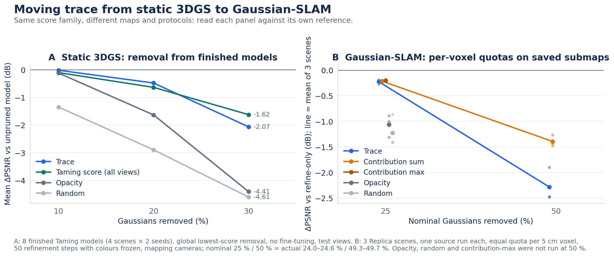
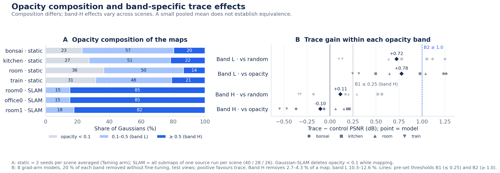

# From Static 3DGS to Gaussian SLAM: Pruning with Reused Training Gradients

**Remove about one quarter of the Gaussians in saved Gaussian-SLAM maps for a mean measured PSNR decrease of 0.22 dB across three Replica scenes.**
Offline compression, mapping cameras, fixed source poses, and one source run per scene.

[Report](REPORT.md) · [한국어 요약](SUMMARY_KO.md) · [Figures / SVG](figures/README.md) · [Data guide](results/README.md) · [CPU example](code/README.md)

This study tests a sensitivity-inspired score built from gradients already computed during training, transfers it
from static 3DGS to Gaussian-SLAM maps, compares scores under a shared spatial budget, and examines which explanations
of the transfer results are supported. The score is a mean squared training-loss gradient, not a full Hessian or a
Fisher estimate over the mapping history.

## Five findings

1. **A measured storage–quality trade-off.** Per-voxel trace pruning removes **24.0–24.6%** of Gaussians for
   **0.19–0.27 dB** PSNR loss. SSIM decreases by less than **0.00044** and LPIPS increases by **0.00063–0.00083**.
   Room0 checkpoints are **24.0% smaller** than equally re-saved/refined controls.
2. **A strong local reference stays visible.** At this removal budget, PSNR is within **0.05 dB of summed rendering
   contribution**, using training gradients without a separate scoring render. Trace is **0.67–1.20 dB** better than
   the tested opacity/random controls. This does not establish score equivalence or a total-time advantage.
3. **The static starting point is useful but conditional.** At 20% post-hoc removal, trace is **+1.16 dB over opacity
   in 8/8 pairs**. Against full-view Taming it is +0.16 dB, with only 4/8 positive pairs.
4. **Spatial allocation was effective; the cause remains open.** Per-voxel budgets supported modest compression.
   The opacity-composition difference is observed; its contribution to transfer performance remains a hypothesis.
   The isolation prediction was unsupported, the statistics-window test was mixed, and the band tests do not prove
   that opaque Gaussians have no trace advantage.
5. **Faster implementation of the same computation.** The measured compression stage falls **57.4%**, from
   2.317 to 0.986 seconds per selected submap, preserving deletion masks in same-input checks. Collection-inclusive
   costs do not establish a robust advantage over equally optimized contribution scoring.

Both the pruned model and its reference receive 50 refinement steps with colours frozen. Checkpoint saving includes
optimizer state and is not a measured VRAM reduction. These numerical losses do not establish perceptual invisibility.



*Static: 8 finished Taming models, global removal, no fine-tuning, test views. SLAM: three Replica scenes, voxel quotas,
50 refinement steps, colours frozen, mapping cameras. Absolute PSNR and effect sizes are not pooled across panels.*



*All 94 SLAM submaps: room0 40, office0 28, room1 26. Band H removes only 2.7–4.3% of each static map; B1 is a threshold
on the sample mean, not an equivalence test. Opacity≥0.5 is an operational split, not a material-opacity measurement.*

## Scope and comparisons

- The contribution comparison above concerns about 25% removal. At about 50%, contribution is **0.6–1.0 dB ahead**.
- Saved-map results do not measure held-out quality, online tracking preservation or end-to-end SLAM speed.
- VCGS, MemGS and Pocket are discussed with their own reference systems and metric definitions. Literature tables
  do not establish a cross-paper ranking. [Local system runs](LOCAL_SYSTEM_COMPARISONS.md) and the online score experiment have their own scopes.
- A completed [online budget-control experiment](ONLINE_COMPARISON.md) compares area/trace/random at exactly 75% of a common
  reference count, with replayed births. This adapted score ablation is distinct from unchanged Pocket-SLAM.
- Static tests use four scenes × two seeds. Historical SLAM compression has one source run per scene. Models,
  datasets and most original renders are not bundled; see the [evidence boundaries](results/README.md).

At the same 25% smaller online point budget, **area, trace and random produced close image-quality metrics**: the PSNR ranges across the three scores were **0.055 / 0.053 dB**, and the LPIPS ranges were **0.00209 / 0.00233** (seeds 0 / 1). Trace showed no clear additional image-quality benefit in this screen. These descriptive ranges do not establish statistical equivalence.

Shared spatial allocation and continued mapping optimization may have reduced score differences. Their contributions were not isolated: no spatial-allocation-off or subsequent-mapping-off control was run. This result therefore does not establish that spatial budgets matter more than the score.

In the completed exact-budget screen (seeds 0 / 1), trace − area PSNR is **-0.055 / -0.016 dB**, LPIPS **-0.00077 / -0.00186**, frontend wall **-1.87% / -0.75%**, and ATE **-0.227 / -1.321 cm**. These are two runs of one short prefix under an adapted policy, not a general superiority or equivalence result. [Full comparison](ONLINE_COMPARISON.md).

## Reproduce the packaged arithmetic and figures

```bash
python scripts/summarize_results.py
python scripts/summarize_followups.py
python -m pip install -r requirements.txt
python scripts/demo_selection.py
python -m unittest discover -s tests
python scripts/make_figures.py
python scripts/make_cost_figure.py --input results/followups/slam_score_cost.json --output figures/fig7_original_cost.png
python scripts/make_implementation_figure.py --input results/followups/slam_implementation.json --output figures/fig6_implementation.png
python scripts/make_transfer_figures.py
python scripts/make_diagnostic_flow.py
python scripts/summarize_online.py
python scripts/make_online_figure.py
```

These commands run on a CPU without requiring Torch or model/data files. They regenerate summaries and figures from
retained metrics; they do not rerun the original GPU experiments. [REPORT.md](REPORT.md) follows the research flow;
[FOLLOW_UP.md](FOLLOW_UP.md) retains detailed controls; [ARCHIVE_REPORT.md](ARCHIVE_REPORT.md) preserves the earlier account.

## AI assistance and license

Claude Code (Anthropic) and Codex (OpenAI) assisted with implementation, execution, review and drafting. Results come
from recorded runs; arithmetic verification does not establish causal explanations or statistical equivalence.

By [Y25ns25k](https://github.com/Y25ns25k). Code: MIT. Original documentation, figures and metric tables: CC BY 4.0.
See [LICENSE](LICENSE) and [THIRD_PARTY.md](THIRD_PARTY.md).
