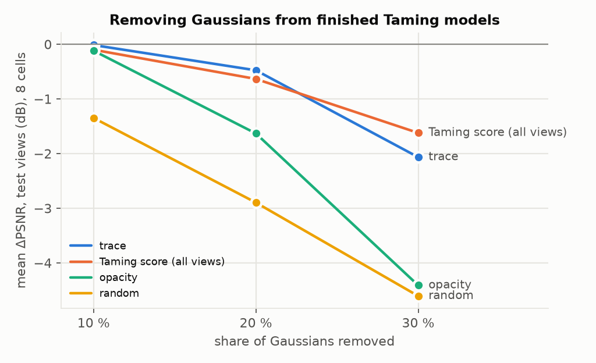
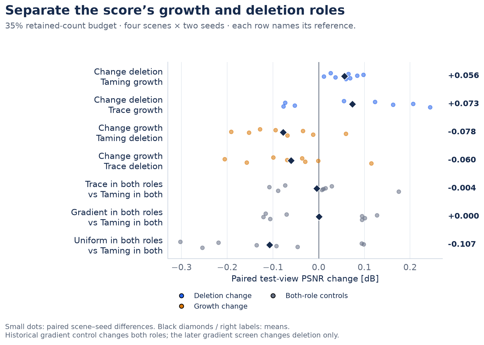
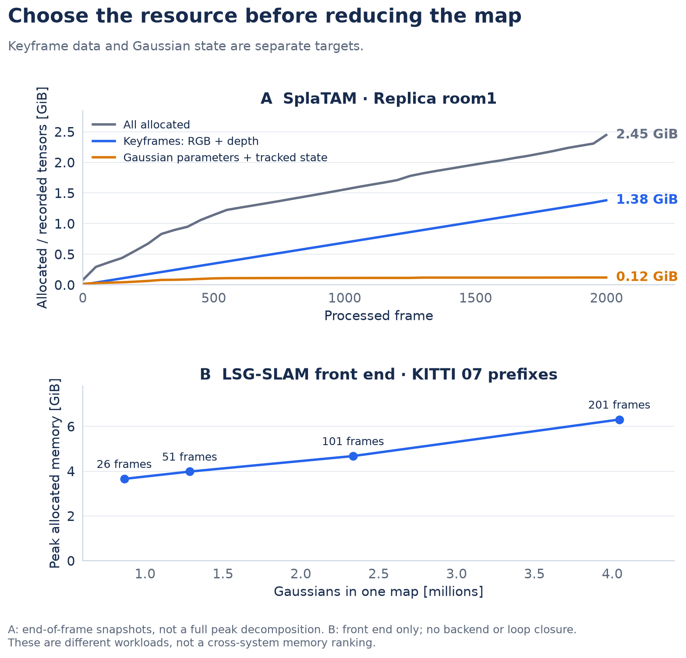
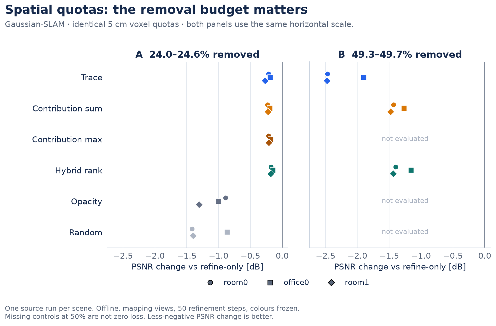
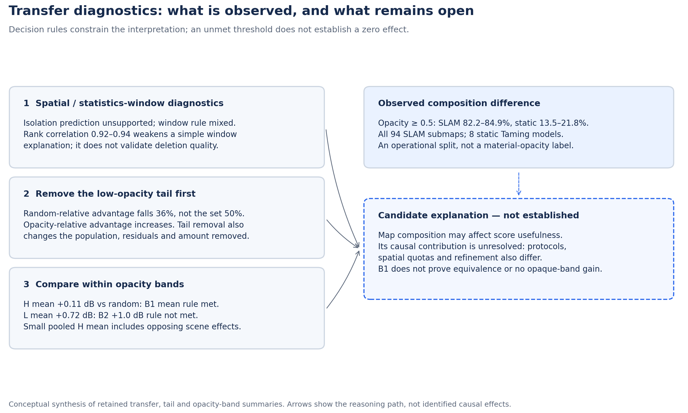
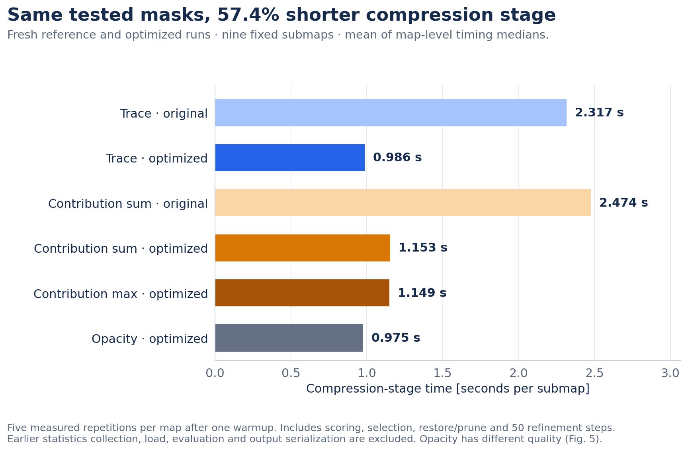

# From Static 3DGS to Gaussian SLAM: Pruning with Reused Training Gradients

**Research report · November 3, 2026**

[Overview](README.md) · [한국어 요약](SUMMARY_KO.md) · [Detailed tables](docs/FOLLOW_UP.md) · [Online budget control](docs/ONLINE_COMPARISON.md)

The principal result is a measured storage–quality trade-off on saved Gaussian-SLAM maps: removing 24.0–24.6% of
Gaussians gives a mean PSNR decrease of about 0.22 dB across three Replica scenes. These are offline results on mapping
cameras with fixed source poses and one source run per scene. Both reference and pruned maps receive the same 50
refinement steps with colours frozen. They do not establish perceptual invisibility or held-out quality.

Trace reuses training gradients and stays within 0.05 dB of summed rendering contribution at this budget. Strong
controls and larger removal budgets limit the score claim. The report follows static deletion tests, SLAM transfer,
spatial constraints, diagnostic tests and implementation cost; it separates observations from causal hypotheses.

## 1. Question and the score

**Score.** Trace is the mean, over the iterations or views in which a Gaussian is visible, of
‖∂L/∂μ‖² + ‖∂L/∂log s‖², the squared training-loss gradient with respect to its centre and log-scale. It is the trace
of a mean gradient outer product, not a Hessian or a full-history Fisher estimate. It can be accumulated from gradients
that training already computes, so it needs no extra scoring render; accumulation and selection still cost work (§6).

**Motivation.** A score that can shrink a map during training, without a separate post-processing pass, is attractive
for SLAM, where maps grow online.

**Questions.**
1. What does trace do in static 3DGS, against weak and strong controls? (§2)
2. What happens when it is used to compress Gaussian-SLAM maps? (§3, positioned in §4)
3. Which explanations of the transfer behavior survive diagnostic tests? (§5)

Cost, implementation and other engineering results follow in §6–§7.

## 2. Static 3DGS: what trace does

**Deleting from finished models.** Eight finished Taming 3DGS models (four scenes × two seeds, 35 % budget) are pruned
by each score at the same count, without fine-tuning, and evaluated on test views.

*A shows mean loss against each model’s unpruned source. B shows all eight trace-minus-Taming pairs, with no pooled uncertainty interval. Positive values in B favour trace; seeds within a scene share scene content.*

| removed | trace | Taming score (all views) | opacity | random |
|---|---|---|---|---|
| 10 % | −0.02 | −0.10 | −0.12 | −1.35 |
| 20 % | −0.48 | −0.63 | −1.63 | −2.90 |
| 30 % | −2.07 | −1.62 | −4.41 | −4.61 |

Mean ΔPSNR (dB) against the unpruned model. At 20 % trace beats opacity by **+1.16 dB (8/8 pairs)**. Against the
render-based Taming score the difference is +0.16 dB with only 4/8 positive pairs, and at 30 % the Taming score is
better. Trace is a strong score against weak controls and comparable to a strong one at low removal; it is not
superior to it.

**Growth and deletion are different roles.** Inside Taming's budgeted training, scores decide both which Gaussians
grow and which are deleted. A crossed experiment separates the two.

*Every row names its candidate/reference and the role changed. Eight small dots are four scenes × two seeds; black diamonds are paired means. The original gradient control changes both roles, unlike the later deletion-only gradient screen.*

- With Taming growth fixed, trace deletion gains +0.056 dB over Taming deletion in 8/8 cells, but replaces about 1.8×
  as many Gaussians. Using trace for growth lowers PSNR under either deletion score (−0.078 / −0.060 dB, 1/8 cells).
- With actual deletions matched at every event (two scenes × two seeds), trace gains +0.074 dB (4/4), below the
  pre-set +0.10 dB adoption bar.
- A deletion-only gradient control is 0.104 dB ahead of a softened trace and 0.178 dB ahead of trace (two scenes,
  fresh seed).

*A preserves the original and turnover-matched screens separately; their policies/data differ. B compares all five fresh arms to the deletion-only gradient control. The +0.10 dB gate belongs to A; B only requires positive mean PSNR and acceptable LPIPS against each Taming/gradient/random control.*

**What carries over to SLAM.** Trace ranks deletions well against opacity and random, is not a growth score, and does
not beat strong render- or gradient-based controls by the pre-set margins. Its distinctive property is cost: it can be
collected during training.

## 3. Moving trace to Gaussian SLAM

**Where Gaussian reduction matters.** Profiling four SLAM systems on a 16 GB GPU showed that live GPU memory was mostly
keyframe data, not Gaussians (SplaTAM room1: 1.38 GiB keyframe RGB/depth against 0.12 GiB Gaussian state; LSG-SLAM's
front end reached 6.3 GiB at 4.05 M Gaussians). The clearest target was the saved map: Gaussian-SLAM keeps about 34 M
Gaussians and 7.69 GiB of checkpoints for one Replica room, split into 50-frame submaps.

*A: SplaTAM room1 end-of-frame snapshots. B: separate LSG-SLAM front-end prefixes on KITTI 07. These are system-specific probes; the axes do not form a cross-system peak-memory comparison.*

**Setting.** Every saved submap of three Replica scenes is pruned by a score, refined for 50 steps with colours frozen,
and compared with a refine-only control that receives the same refinement, on the mapping cameras. The source
trajectory is copied, so this is an offline approximation of pruning at submap closing; it says nothing about tracking.

**Initial global-ranking diagnostic.** Deleting the globally lowest-trace Gaussians of each submap was worse than random at 25 / 50 /
75 %. In a diagnostic sample (room0, submap 10), 50 % global deletion emptied 10.3 % of the occupied 5 cm voxels,
against 2.9 % for random. (This early screen also had a colour-refinement confound, corrected before the results
below.)

**Per-voxel budgets support modest compression.** Each occupied 5 cm voxel loses `floor(share × count)` Gaussians, lowest score first.

*A: 8 finished Taming models, global lowest-score removal, no fine-tuning, test views. B: 3 Replica scenes, one source run each, equal quota per 5 cm voxel, 50 refinement steps with colours frozen, mapping cameras; nominal 25 % / 50 % = actual 24.0–24.6 % / 49.3–49.7 %. Opacity, random and contribution-max were not run at 50 %. The two panels have different references and protocols.*

At nominal 25 % removal, ΔPSNR (dB) against refine-only:

| scene | trace | contribution sum | contribution max | opacity | random / voxel |
|---|---|---|---|---|---|
| room0 | −0.215 | −0.229 | −0.216 | −0.888 | −1.418 |
| office0 | −0.188 | −0.191 | −0.178 | −0.998 | −0.864 |
| room1 | −0.270 | −0.222 | −0.210 | −1.308 | −1.400 |

- Trace loses 0.19–0.27 dB and beats opacity and random by 0.67–1.20 dB. Contribution sum/max are within 0.06 dB of it.
- The room0 checkpoints shrink from 4.939 to 3.755 GiB (**24.0 %**), against equally re-saved, refined checkpoints that
  include optimizer state.
- At about 50 % removal, contribution beats trace by 0.6–1.0 dB. Extra refinement, densest-voxel caps and a hybrid rank
  failed their pre-set rules.

*Both panels use the same PSNR scale. Shape identifies scene; row identifies score. One source run per scene. At nominal 25%, actual removal is 24.0–24.6%; at nominal 50%, it is 49.3–49.7%. Missing controls are explicitly unmeasured.*

## 4. Position against baselines and related methods

**Within this study** (same maps, same quotas, same refinement):

| comparison | 25 % removal | 50 % removal |
|---|---|---|
| trace vs opacity / random | +0.67 to +1.20 dB | not run |
| trace vs contribution sum / max | within 0.06 dB | contribution 0.6–1.0 dB better |

Trace stays numerically close to contribution scoring at modest removal and falls behind at high removal.
This is a descriptive comparison, not a statistical equivalence result.

**Related SLAM compression methods.** Online compression for Gaussian SLAM already exists. Absolute numbers across
papers are not comparable: the same Gaussian-SLAM baseline is reported at 34.78 / 36.83 / 39.15 dB (room0 / room1 /
office0) in VCGS-SLAM's table, while our refine-only reference (38.91 / 41.91 / 46.32 dB) is within 0.1 dB of the
original Gaussian-SLAM paper (38.88 / 41.80 / 46.40 dB). Each method is therefore described only by its change against
its own baseline, and storage, model size, peak VRAM and FPS are kept apart.

| method | baseline in its paper | quality change | resource change | when applied |
|---|---|---|---|---|
| [VCGS-SLAM](https://arxiv.org/html/2403.11247v3) (masking, quantization) | its Gaussian-SLAM run | room0 / room1 / office0: −0.09 / +0.48 / +0.60 dB | checkpoint memory −5.4 % (Replica Table 10, 101.48 → 96.03 MB); mapping time per frame −13.9 %; rendering FPS +42.7 % | online |
| [MemGS](https://arxiv.org/html/2509.13536v1) (voxel-space merging, ORB-SLAM3 front end) | Photo-SLAM | Replica office / room averages: +1.07 / +0.53 dB | GPU memory at the end of the run −22 % / −20 % | online |
| [Pocket-SLAM](https://arxiv.org/html/2606.24796v1) (rendering-area pruning, image-tile budget) | its unpruned 3DGS-SLAM baselines (EuRoC, KITTI) | accuracy reported as preserved; quality collapses without the tile budget | memory −60 % or more, FPS more than 2× (abstract) | online |
| this study (trace, 5 cm voxel quotas) | refine-only on the same source | −0.215 / −0.270 / −0.188 dB | checkpoint −24.0 % (room0, incl. optimizer state, 4.939 → 3.755 GiB) | offline, at submap closing |

VCGS Table 10 defines its “memory” as checkpoint memory, not peak GPU memory; its Replica figures are not a
room0-only measurement. MemGS reports allocated GPU memory at run completion.
Relative changes from different experiments are not a ranking. Code exists for VCGS, MemGS and Pocket, but a
released implementation or branch is not automatically a full-paper reproduction. The separately executed local
system runs ([all eight configurations and numeric extract](docs/LOCAL_SYSTEM_COMPARISONS.md)) and the
[online exact-budget score ablation](docs/ONLINE_COMPARISON.md) have their own input, pose, timing
and model-representation scopes. The saved-map result above measures checkpoints, not peak VRAM or online FPS.

At the same 25% smaller online point budget, **area, trace and random produced close image-quality metrics**: the PSNR ranges across the three scores were **0.055 / 0.053 dB**, and the LPIPS ranges were **0.00209 / 0.00233** (seeds 0 / 1). Trace showed no clear additional image-quality benefit in this screen. These descriptive ranges do not establish statistical equivalence.

Shared spatial allocation and continued mapping optimization may have reduced score differences. Their contributions were not isolated: no spatial-allocation-off or subsequent-mapping-off control was run. This result therefore does not establish that spatial budgets matter more than the score.

In the completed exact-budget screen (seeds 0 / 1), trace − area PSNR is **-0.055 / -0.016 dB**, LPIPS **-0.00077 / -0.00186**, frontend wall **-1.87% / -0.75%**, and ATE **-0.227 / -1.321 cm**. These are two runs of one short prefix under an adapted policy, not a general superiority or equivalence result. Area also has higher SSIM in both seeds; trace has lower LPIPS and ATE. Random is faster than trace in both seeds.
The small time gaps do not isolate ranking or gradient-collection cost.
See the [online appendix](docs/ONLINE_COMPARISON.md) for all eight runs, count checks and timing boundaries.

## 5. Spatial constraints and unresolved transfer diagnostics

The order of evidence is: an initial global-ranking diagnostic performed poorly; common voxel quotas supported
modest compression; subsequent diagnostics investigated remaining differences. The first diagnostic also had a colour-
refinement confound. Neither that contrast nor the opacity analysis establishes why spatial quotas were effective.

| Test | Observation / fixed-rule outcome | Interpretation boundary |
|---|---|---|
| Transfer diagnostic, 8 static models and 94 SLAM submaps | H1 isolation prediction unsupported; window rule R4 mixed; stored/post-hoc rank correlation 0.92–0.94 | Weakens the simple window explanation without excluding it; rank correlation does not prove identical deletion masks or quality |
| Tail removal | Random-relative trace advantage fell 36%, 2.42→1.55 dB; opacity-relative advantage increased; the pre-set 50% criteria were not met | Does not show that the tail has no role. Removing it also changes the population, amount removed, residuals and recomputed scores |
| Opacity bands, 8 grad-arm models | H mean +0.113 dB vs random and −0.105 vs opacity: B1 met. L +0.723 vs random, 8/8 positive, but B2 +1.0 dB not met | B1 tests a sample-mean threshold, not absence of an advantage or equivalence |

*All SLAM submaps: room0 40, office0 28, room1 26. H removes 2.7–4.3% of a static map; L removes 10.3–12.6%.
Static diagnostics use global removal without refinement and test views. Saved-map SLAM uses voxel quotas,
refinement and mapping cameras. These differences prevent a composition-only causal explanation.*

At activated opacity≥0.5, all-submap shares are 84.78%, 84.86% and 82.19%; the eight static Taming models range from
13.5% to 21.8%. This is an operational split, not a material-opacity classification.

H's trace-minus-random scene means are bonsai −0.005, kitchen +0.541, room +0.247 and train −0.329 dB. The small overall
mean partly reflects cancellation. Treating four scene means as independent for a descriptive one-sided t calculation
gives a 95% upper bound of about +0.55 dB versus random (+0.28 versus opacity); a +0.25 dB gain is not ruled out.
The rank helper does not average tied ranks; the reported correlations are not exact tie-corrected Spearman values.
The largest listed stored/post-hoc metric change is office0 5 cm E25: 2.7924→2.5999, about 0.1925, not ≤0.08.

**Hypothesis, not established:** opacity composition may contribute to transfer differences. Visibility, spatial
layout, losses, evaluation views and refinement also differ. The diagnostics do not show that trace helps only among
semi-transparent points, exclude H1/H3 in general, or establish that low gradient identifies converged essential surfaces.
The first two plans and rule scripts were committed before full runs, with earlier smoke runs disclosed; that is not
an independently verified claim that every experiment was preregistered before any execution.

*Conceptual reading of the fixed-rule tests. A failed threshold is not proof of no effect. The dashed edge marks a
candidate explanation, not a measured causal result.*

## 6. Cost and implementation

Trace's remaining practical argument is cost, so it was measured against contribution scoring, which needs an extra
render-and-backward pass.

- **Before optimisation**, trace closed a submap 7.9–8.2 % faster than contribution once statistics existed, but
  mapping plus compression cost +6.59 % (room0) and +0.81 % (office0) more, because collection is not free.
- **Same-score implementation work.** Dense statistics updates and stable packed-key voxel sorting keep the score,
  quotas and tie-breaking; 264 same-input checks reproduced the original deletion masks. The compression stage fell
  from **2.317 to 0.986 s per submap (−57.4 %)**, and is 14.5 % / 14.2 % shorter than contribution sum / max given the
  same selector optimisation. This is a stage measurement on nine saved submaps, excluding earlier collection; it is
  not SLAM speed.
- **Collection included**, against optimised contribution sum, the mean changes are −0.37 % (room0) and −0.05 %
  (office0), with trace cheaper in 3 of 6 scene–seed pairs. No robust total-cost advantage is established.

*All six frozen comparison arms are shown, including cheap opacity. Bars are actual complete-stage medians per map, averaged over nine maps. Statistics collection is outside this resident-compression boundary.*

*Each circle is one scene–seed pair; black diamonds are scene means. Negative values favour trace. The selected cost sum includes GT-pose mapping, collection, native checkpoint I/O, common loading and offline compression. It is not online SLAM FPS. The marked contribution-max comparison misses the PSNR guard.*

All 12 fixed-source quality comparisons pass the descriptive guards (PSNR ≥ −0.10 dB, LPIPS ≤ +0.002, depth L1 ≤
+0.1 mm); 1 of 24 direct prefix comparisons misses the PSNR guard by 0.001 dB. Full timing boundaries, phase
breakdowns (Fig. 10, 11) and every seed are in [FOLLOW_UP.md](docs/FOLLOW_UP.md).

## 7. Engineering results outside the score question

- **Flow4DGS-SLAM memory.** At about 2× keyframe density, three baseline runs ran out of memory in colour refinement;
  three runs with opt-in memory options (unread buffers released, no optimizer copy in the frontend, a frontend leak
  fixed) completed at 9.11–9.53 GiB profiled peak. Quality equivalence at that density is unconfirmed.
- **Exact temporal storage.** Dropping never-rendered pre-birth slots and merging unchanged copies cuts the modelled
  per-keyframe centre bank by **44.8 %** with matching renders in the original checks. This is a storage model, not a
  runtime VRAM measurement.
- **Evaluation repairs.** A mean-error ATE reported as RMSE, world-to-camera translations used as camera centres, an
  unequal colour-refinement confound and incomplete scoring-view coverage were found and corrected; see
  [the evaluation correction record](docs/SETUP_AND_CORRECTIONS.md#evaluation-corrections).

*Three repeated seed-0 runs. The storage axis is modeled centre-bank MiB; the quality axis uses retained metrics against each dense run. Original bit-identical-render checks were recorded, but their images are no longer bundled. Online use still needs the slot used by flow loss and copy-on-write handling.*

## 8. Reproducibility and evidence boundaries

The package holds measured metric tables, independent numerical helpers, a CPU selection example with oracle tests,
and scripts that regenerate every figure on a CPU. [results/transfer/](results/transfer) holds the summaries of the
three §5 tests and the opacity composition of every map; [the data guide](results/README.md) lists fields, filters and
gaps. [figure_data.json](results/figure_data.json) binds Figs. 1–6 and 8–11 to input hashes; Fig. 12–13 are drawn by
`scripts/make_transfer_figures.py` directly from the JSON named in its header. Fig. 14 is a conceptual
evidence map generated by `scripts/make_diagnostic_flow.py`.

Not included: upstream code and local patches, full configurations, dataset frames, model weights, renders, and the
per-model raw outputs of the §5 tests (their summaries are included). Some original checkpoints and images were deleted
after extraction, so pixel parity and several diagnostics cannot be repeated from this release. Statements that a rule
was fixed before a run are author-reported. [THIRD_PARTY.md](THIRD_PARTY.md) lists systems, datasets and
redistribution scope; [setup and correction notes](docs/SETUP_AND_CORRECTIONS.md) preserve the relevant environment and evaluation details.

## 9. Conclusions and limitations

| claim | supported by | boundary |
|---|---|---|
| Trace is a strong deletion score against weak controls in static 3DGS | 8/8 pairs at 20 % vs opacity | Comparable to, not better than, a render-based score; not a growth score |
| Spatial quotas were effective in the tested saved maps | global ranking worse than random; voxel quotas 0.67–1.20 dB better than random/opacity | Offline, mapping views, one source run per scene; early global diagnostic also had a colour confound |
| Trace is close to contribution at modest removal, behind it at high removal | ≤ 0.06 dB at 25 %; 0.6–1.0 dB behind at 50 % | Three Replica scenes |
| The opacity composition of the maps differs sharply | measured on all maps | Descriptive |
| That difference contributes to the weaker transfer | composition difference observed; small pooled H effect | Hypothesis; B1 is not an equivalence test, B2 not met, alternatives not excluded |
| Same-score implementation is faster | −57.4 % compression stage, identical masks | Stage only; no robust total-cost or SLAM-speed gain |

Limits: one RTX 5070 Ti (16 GB, WSL2); static tests on four scenes × two seeds; SLAM compression on three Replica scenes
with one source run each, evaluated on mapping cameras with copied poses. That saved-map experiment measures no
online latency or tracking impact. The separate online appendix uses a controlled short KITTI prefix and live
tracking; it does not provide held-out quality or complete SLAM-system timing.

A useful extension would integrate per-voxel pruning at submap closing in an online system, reserve held-out views
before mapping, keep an optimised contribution control, and measure closing latency, tracking, peak VRAM and stored size
separately. The report documents the bounded saved-map study and a separate online score ablation; it keeps
measured outcomes, implementation changes and unresolved explanations distinct.
