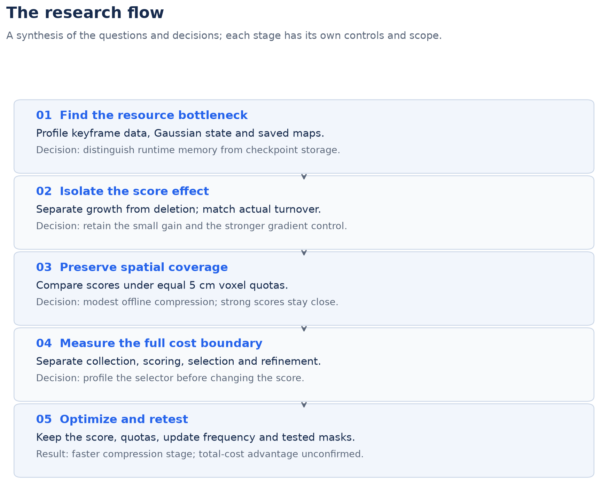
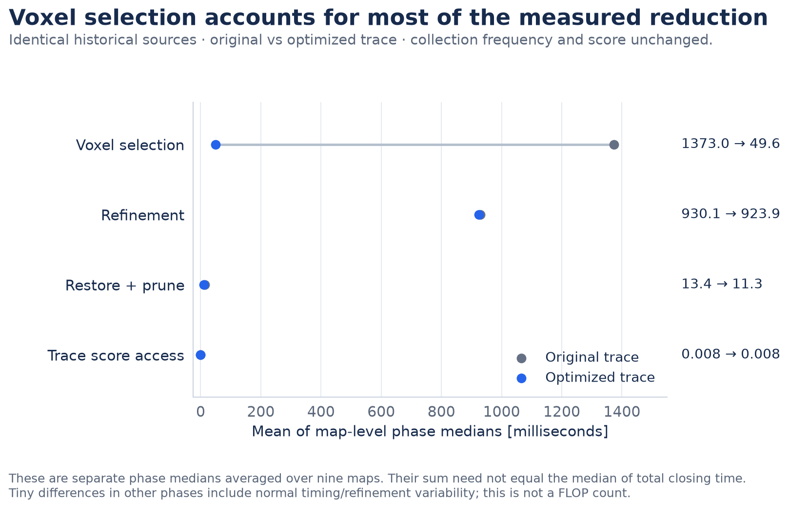
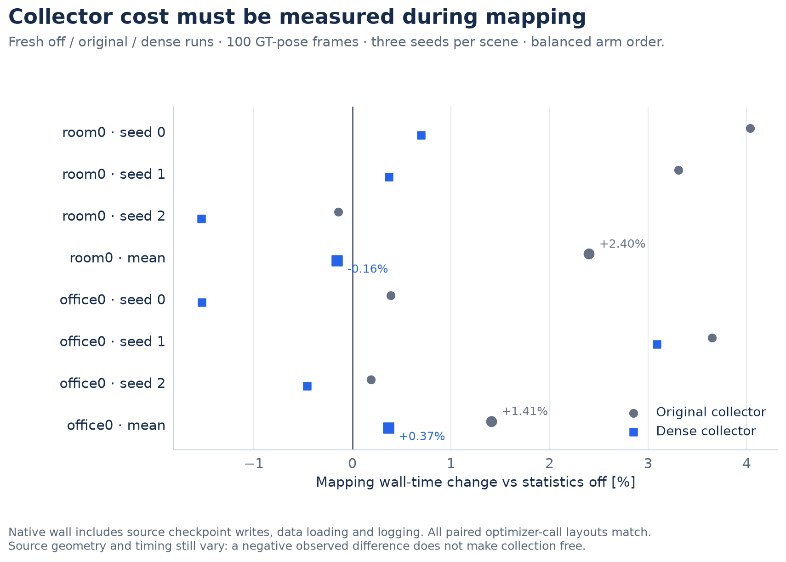
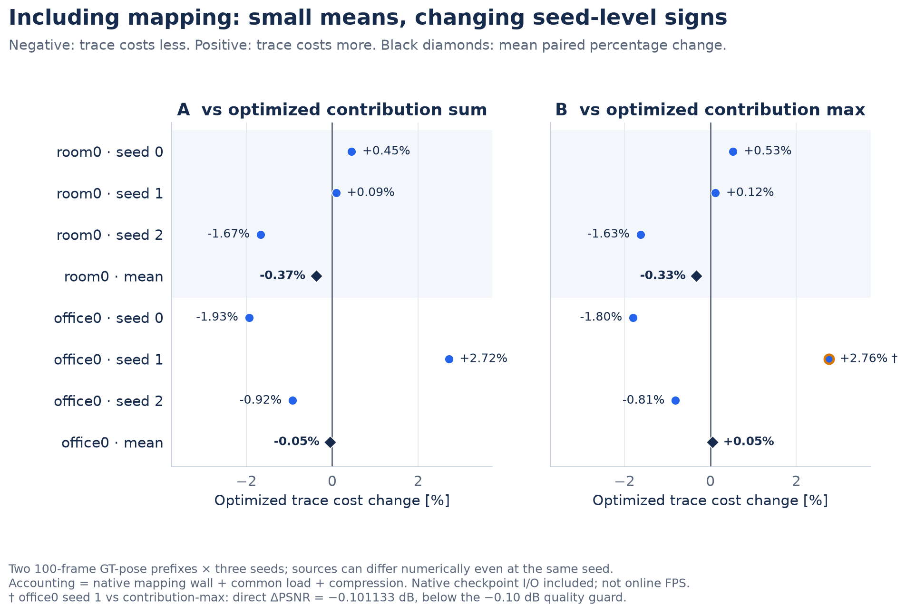

# Gaussian SLAM: Resource Profiling and Compression Optimization

**Research report · integrated presentation, November 3, 2026**

[Overview](README.md) · [한국어 요약](SUMMARY_KO.md) · [Detailed tables](FOLLOW_UP.md) · [Figure index / vector files](figures/README.md) · [Data guide](results/README.md)

The study began with a low-cost sensitivity score and ended with a narrower engineering result: the tested
compression computation can be implemented faster, while a general score-quality or whole-workload advantage
remains unconfirmed. The following chapters explain why each experiment was needed and what its result changed.

**Three findings to retain:** modest per-voxel compression has a measurable storage–quality trade-off;
strong controls constrain the trace-ranking claim; same-score implementation work cuts the measured compression
stage by **57.4%**, but collection-inclusive seed results do not establish a robust total-cost gain.

## 1. Research question and experiment map

**Question.** Can a sensitivity score derived from gradients already computed in training reduce the resource
that limits Gaussian SLAM, while preserving useful map quality?

Three separate conditions must hold: Gaussian reduction must target a real bottleneck; the ranking must survive
matched-budget and strong-score controls; and its collection plus selection costs must be worthwhile. A positive
result in one condition does not establish the other two.

*Research questions and decisions synthesized across the study. This diagram is not a causal proof or a timestamped preregistration history. The static quality screens and SLAM cost screens have different data and controls.*

| Stage | Controlled comparison | Observation | Next decision |
|---|---|---|---|
| Resource target | Record keyframe, Gaussian-state and storage measures separately | Keyframe data can dominate; saved submaps are a direct storage target | Test compression in saved Gaussian-SLAM submaps |
| Score quality | Separate growth/deletion, then match actual turnover | Small residual gain; gradient remains strong | Keep trace as a tested score, without a quality-superiority claim |
| Spatial coverage | Equal 5 cm voxel quotas, matching refinement | Modest removal is usable; strong contribution scores are close | Measure implementation cost |
| Cost boundary | Resident compression vs collection-inclusive mapping + compression | Extra-render avoidance is insufficient; selection is costly | Optimize the same computation |
| Final validation | Fresh references, shared selector optimization, unchanged quota/score | Faster stage, mixed seed-level total cost | Report a bounded implementation result |

The rest of the report follows this logic. [The corrected earlier record](ARCHIVE_REPORT.md) retains the porting,
tracking diagnostics, original budget table and evaluation repairs without making them prerequisites for this narrative.

## 2. Find the resource bottleneck

**Why this test?** Reducing Gaussian count can affect render/optimization work and stored maps, but it does not
remove all keyframe data. A resource profile is needed before choosing the intervention.

*A: SplaTAM room1 end-of-frame snapshots. B: separate LSG-SLAM front-end prefixes on KITTI 07. These are system-specific probes; the axes do not form a cross-system peak-memory comparison.*

| System and tested scope | Observation | Implication |
|---|---|---|
| SplaTAM, Replica room1, 2,000 frames | Final keyframe RGB/depth: 1.38 GiB; recorded Gaussian parameters/state: 0.12 GiB | Fewer Gaussians alone does not remove the dominant recorded keyframe component |
| Flow4DGS-SLAM, TUM walking_xyz | Keyframe data grows about 27 MiB per keyframe; temporal parameters are 8–12% of allocated memory in the profiled configuration | Target unused buffers, copies and leaks before changing representation capacity |
| LSG-SLAM, KITTI 07 front end | A 201-frame prefix reaches 4.05 M Gaussians and about 6.3 GiB peak allocated memory | The measured front end does not reproduce a full backend/loop-closure bottleneck |
| Gaussian-SLAM, saved room0 maps | About 34 M Gaussians and 7.69 GiB of source checkpoints | Saved maps provide a concrete compression target; source files include state that must be controlled in size comparisons |

**Execution improvement.** At approximately 2× keyframe density in Flow4DGS, three baseline runs fail during
colour refinement and three runs with memory options complete at 9.11–9.53 GiB profiled peak allocated memory.
The options release unread buffers, avoid unnecessary frontend optimizer copies and address a frontend leak.
These are configuration-level runs, not identical-trajectory deterministic replays. At this density, quality
equivalence is unconfirmed: the retained study record reports two optimized runs with lower pre-refinement PSNR
than all five available off-runs; those additional diagnostic records are not all bundled here.
A 2.49× run completes but loses tracking. Completion is an engineering result, not proof of useful denser mapping.

**Exact storage baseline.** Before lossy reduction, the study models removing invisible pre-birth slots and
merging unchanged temporal-centre copies. The combination saves **44.8% of centre-bank storage**,
including Adam moments and indices. This does not measure runtime VRAM or total checkpoint saving.

*Three repeated seed-0 runs. The storage axis is modeled centre-bank MiB; the quality axis uses retained metrics against each dense run. Original bit-identical-render checks were recorded, but their images are no longer bundled. Online use still needs the slot used by flow loss and copy-on-write handling.*

**Decision.** Keep memory feasibility, modeled storage, saved-map size and latency as separate outcomes. The next
score experiments target Gaussian reduction; they do not claim to solve every SLAM memory bottleneck.

## 3. Separate ranking quality from growth and turnover

**Signal.** Trace is the accumulated mean squared training-loss gradient for each Gaussian’s centre and
log-scale. Equivalently, it is the trace of a mean gradient outer product. It is not a Hessian estimate or a
Fisher estimate over the full mapping history. The Gaussian-SLAM accumulator resets at each submap optimization
call. Reusing these gradients avoids an additional scoring-render pass, but accumulation and selection still cost work.

**Control 1: separate growth and deletion.** In budgeted static 3DGS, changing the score can change which points
grow as well as which points are deleted. A four-scene/two-seed crossed experiment tests these roles separately.

*Every row names its candidate/reference and the role changed. Eight small dots are four scenes × two seeds; black diamonds are paired means. The original gradient control changes both roles, unlike the later deletion-only gradient screen.*

With Taming growth fixed, trace deletion gains about +0.056 dB against Taming deletion, in 8/8 cells. However,
actual replacements are about 1.8× greater. That experiment alone cannot attribute the gain to ranking.
Using trace for growth lowers the paired mean under either fixed deletion score. The historical pure-trace
arm is about 0.0048 dB below the both-role gradient arm; this must not be confused with the crossed arm.

**Control 2: match actual deletions.** Two existing scenes × two seeds × two deletion scores give eight retained
30,000-iteration conditions. The comparison fixes the growth rule and actual deletions at each event. Trace gains
**+0.0741 dB**, in 4/4 pairs; mean LPIPS changes by -0.000682. This misses the
fixed +0.10 dB mean-PSNR gate. Candidate shortages required a common growth-threshold relaxation. One previously
completed bonsai pair is reused only after confirming that the fallback was never needed there. This is a result
under amended common growth, not unchanged upstream Taming or a full causal explanation of the original gain.

**Control 3: allow a small gain, but face stronger references.** A fixed soft-trace offset (+0.1 after positive-median
normalization) is tested with Taming, trace, gradient and random deletion on bonsai/kitchen at fresh seed 3.
All five arms share common growth and the historical Taming seed-1 deletion schedule. All ten 30k conditions finish.
Soft trace gains **+0.0740 dB** over trace, but LPIPS worsens by
+0.000440; it remains **-0.1037 dB** behind
gradient in PSNR. Gradient has the highest PSNR in both scenes.

*A preserves the original and turnover-matched screens separately; their policies/data differ. B compares all five fresh arms to the deletion-only gradient control. The +0.10 dB gate belongs to A; B only requires positive mean PSNR and acceptable LPIPS against each Taming/gradient/random control.*

Neither trace candidate passes B’s expansion rule, so the conditional six-run seed-4 extension is not run. The
offset is not retuned. One bonsai view explains much of the gain over Taming; the primary comparison remains
unchanged and the view-exclusion diagnostic is retained in [the detailed record](FOLLOW_UP.md#2-a-small-improvement-still-has-to-face-the-gradient-control).

**Decision.** Keep the small observed score effects, but stop expanding this static trace-quality candidate.
A later cost result must stand on its own; it does not overturn the gradient control.

## 4. Test the removal budget on finished models

**Why this test?** A score that is useful at a modest removal budget may delete important geometry when pushed
further. Eight finished Taming models are pruned without fine-tuning, at the same count budget for each score.

*A shows mean loss against each model’s unpruned source. B shows all eight trace-minus-Taming pairs, with no pooled uncertainty interval. Positive values in B favour trace; seeds within a scene share scene content.*

At 20% removal, trace loses about 0.48 dB versus 1.63 dB for opacity: a +1.16 dB difference. Against the full-view
Taming score the observed mean difference is only +0.16 dB, with 4/8 positive pairs. At 30% removal, Taming is
better (about −1.62 dB versus −2.07 dB). These observations do not establish equivalence or score superiority.

**Decision.** Include weak and strong controls, and keep removal budgets separate. The next SLAM experiment uses
spatial quotas to address coverage, rather than assuming that a globally low score implies safe deletion.

## 5. Preserve coverage when compressing SLAM submaps

**Why this test?** Early global ranking could remove converged surfaces. In one diagnostic sample, 50% global
pruning emptied 10.3% of occupied 5 cm voxels, versus 2.9% for random. That early comparison also had a colour-
refinement confound; it motivates a coverage test but is not clean quantitative evidence for a causal mechanism.

**Controlled setting.** For every occupied 5 cm voxel, delete `floor(removal_share × count)` Gaussians, lowest
score first. The same-source score arms have identical voxel quotas, frozen colours, 50 optimizer steps
(51 forward/backward passes), and a refine-only reference with matching work. Three Replica scenes are evaluated
on mapping cameras. The saved source trajectory is copied: identical ATE is true by construction, not evidence
that online tracking is preserved.

*Both panels use the same PSNR scale. Shape identifies scene; row identifies score. One source run per scene. At nominal 25%, actual removal is 24.0–24.6%; at nominal 50%, it is 49.3–49.7%. Missing controls are explicitly unmeasured.*

At nominal 25% removal, observed PSNR changes against refine-only are:

| Scene | Trace | Contribution sum | Contribution max | Opacity | Random / voxel |
|---|---|---|---|---|---|
| room0 | -0.215 | -0.229 | -0.216 | -0.888 | -1.418 |
| office0 | -0.188 | -0.191 | -0.178 | -0.998 | -0.864 |
| room1 | -0.270 | -0.222 | -0.210 | -1.308 | -1.400 |

Trace loses 0.19–0.27 dB. Contribution-sum/max are within 0.06 dB; no trace PSNR advantage is established.
Trace has slightly better LPIPS in the three historical scenes, while contribution-sum has lower depth error in two.
The room0 checkpoint comparison is **4.939 → 3.755 GiB**, a **24.0% saving**, relative to equally re-saved/refined
checkpoints including optimizer state. The 7.69 GiB original source is not the denominator for this saving.

At approximately 50% removal, contribution beats trace by 0.6–1.0 dB. Extra refinement, densest-voxel caps and
hybrid ranks fail their original decision rules. The original diagnostics and all corrected rows remain available.
This is not a full reproduction or speed comparison of Pocket-SLAM, Mini-Splatting or PUP.

**Decision.** Modest offline spatially stratified compression has a storage–quality trade-off worth measuring.
Trace’s remaining rationale is its scoring cost, not an established quality lead over contribution.

## 6. Measure the cost boundary before optimizing

**Why this test?** Existing training gradients do not make a score free. Trace maintains accumulators and counts;
contribution performs an extra rendering/backward pass over scoring views. Both still need selection and refinement.

| Measurement | Included | Excluded / interpretation |
|---|---|---|
| Resident compression stage | Scoring, selection, restore/prune, 50 refinement steps | Earlier collection, common load, quality evaluation, compressed-model serialization |
| Native mapping wall | Synchronized `GaussianSLAM.run`, including collection when enabled, data reads, logging and source-checkpoint writes | Constructor/import and post-run record extraction; GT pose is used |
| Selected mapping + compression sum | Native wall + common load/prepare + resident compression | Deferred validation, compression evaluation/import and compressed-output serialization; not full CLI wall or online FPS |

The first cost screen uses three predetermined saved submaps in each of three scenes. It takes one warmup and
five measured timing repeats per arm. These repeats are not five independent training seeds. Contribution uses
colour-only autograd to avoid unnecessary model-leaf gradients; sum/max each pay the full scoring pass cost.
It is a local implementation control, not a specialized contribution CUDA kernel or an official full-method comparison.

*A and B have different cost boundaries. A uses existing statistics; B compares collection-on trace sources with collection-off contribution sources on two short GT-pose prefixes, three seeds each. Earlier-run absolute timings are not reused as the optimized run’s reference.*

With statistics present, trace closes in 2.734 s per selected submap, versus
2.968/2.979 s for contribution-sum/max. The stage is
7.89%/8.23% faster. But mapping plus compression costs **+6.59% in room0** and
**+0.81% in office0** against contribution-sum. No net advantage is established.
Selection alone accounts for about 55% of trace’s resident closing time.

**Decision.** Optimize statistics updates and voxel selection while preserving the score, quota and tested
numeric results. Give the same selector improvement to contribution controls; do not make the reference artificially slow.

## 7. Optimize the same computation and validate it

**Collector change.** Dense `torch.where` updates retain the original PyTorch squared-gradient reduction and
avoid dynamic-length Boolean gathers. Collection remains every eligible step; the score formula is unchanged.

**Selector change.** Keep the original CPU float32 voxel/importance arithmetic, pack collision-free int64 voxel
keys, and use stable CUDA sorting with original-index tie breaking. Bounding-box overflow falls back to a safe
coordinate sort. One backend is chosen globally from development timing; no scene-specific backend choice is used.

| Check | Retained result | What it does not prove |
|---|---|---|
| 63 real gradient packets + 96 collector edge cases | Dense accumulator/count buffers match original float32 bits | Identical independently trained maps or cross-hardware equivalence |
| 45 real score/submap cases + 26 selector edge cases | NumPy/CUDA masks match the reference | All possible future inputs or an all-GPU voxel arithmetic path |
| 264 deferred same-input comparisons in frozen runs | Optimized selection masks match the original CPU oracle | Bit-identical rasterizer refinement; oracle timing is outside the benchmark |
| Single-kernel Triton candidate | Rejected after reduction-rounding differences | Its speed is not an accepted result |

A first profiler attempt is stopped and excluded after an unnecessary allocation in its shape-only proxy is fixed.
The corrected v2 development run chooses the backend. The final comparison freezes the implementation and then
reruns original and optimized references on the same nine sources with the same refinement RNG and colour freeze.

*Separate phase medians, averaged across the same nine maps. The selector changes from about 1.373 s to 0.050 s. Phase medians are not added to manufacture a closing-time median; total-stage comparisons use Fig. 6’s complete-stage medians.*

*All six frozen comparison arms are shown, including cheap opacity. Bars are actual complete-stage medians per map, averaged over nine maps. Statistics collection is outside this resident-compression boundary.*

The compression stage falls from **2.317 s to 0.986 s** per submap, **57.44% shorter** than fresh
original trace. Against equally optimized contribution-sum/max, it is **14.49% / 14.17% shorter**.
Opacity is slightly cheaper but has worse observed quality in the historical modest-removal comparison (Fig. 5).
These results concern the tested local implementations and source sizes, not all pruning methods.

**Decision.** Same-score implementation work gives a measurable stage-latency result. Next, include collection
and fresh mapping to determine whether that result survives a wider cost boundary.

## 8. Retest collection-inclusive cost and quality

**Fresh controls.** Two 100-frame GT-pose prefixes × three seeds × statistics off/original/dense produce 18 native
mapping runs. Arm order is rotated across seeds. Optimizer-call/step counts and keyframe layouts match within each
scene–seed block. Native geometry and Gaussian counts can still vary numerically.

*All seed-level mapping-wall changes are relative to that seed’s statistics-off run. Means average the paired percentages. An observed negative difference does not imply negative or zero physical collection cost.*

| Scene | Dense vs original mapping wall | Dense vs statistics-off wall |
|---|---|---|
| room0 | -2.48% | -0.16% |
| office0 | -1.03% | +0.37% |

Each new source is then compressed with its own refine-only control. Original-statistics sources use original
trace; dense-statistics sources use optimized trace; statistics-off sources use optimized contribution-sum/max
and opacity. Both direct quality deltas and differences relative to each source’s refine-only result are retained.

*Two contribution controls are shown on one percentage scale, with all six scene–seed pairs and both scene means. Means are not ratios of separately averaged timings. The marked direct quality guard failure remains a failure.*

| Scene | Seed | Optimized trace [s] | Optimized contribution sum [s] | Trace change |
|---|---|---|---|---|
| room0 | 0 | 122.5591 | 122.0055 | +0.454% |
| room0 | 1 | 122.4033 | 122.2915 | +0.091% |
| room0 | 2 | 122.5383 | 124.6144 | -1.666% |
| office0 | 0 | 86.3608 | 88.0636 | -1.934% |
| office0 | 1 | 87.8029 | 85.4804 | +2.717% |
| office0 | 2 | 86.8040 | 87.6116 | -0.922% |

Against optimized contribution-sum, the mean changes are **-0.374%** and
**-0.046%** in room0/office0. Trace costs less in 3/6 pairs; the signs vary.
Against optimized contribution-max the means are -0.326% /
+0.050%. These small averages do not establish a robust whole-workload advantage.

Against the **fresh original trace implementation**, the same accounted totals change by
-4.67% / -3.57% in room0 / office0.
That is the implementation comparison; the optimized-score comparison above is the test of trace's remaining
practical advantage. The two references answer different questions.

**Quality boundary.** All 12 fixed-source scene/control comparisons pass the descriptive guards: PSNR ≥−0.10 dB,
LPIPS ≤+0.002 and depth L1 ≤+0.1 mm. They are not equivalence tests. Among 24 direct prefix comparisons, office0
seed 1 against contribution-max has ΔPSNR **−0.101133 dB**, narrowly missing the PSNR guard; its LPIPS/depth guards
pass. This near-boundary miss is not rounded into a pass. All seed/control metrics are in [the supplement](FOLLOW_UP.md#4-optimize-the-same-computation-before-changing-the-method).

Compression peak allocated memory across the nine fixed-source cases is 1126.50 MiB for original trace and
1127.64 MiB for optimized trace. Temporary GPU sort buffers are used; this is not a VRAM-saving result.

**Decision.** Report the stage-latency improvement and the unresolved total-cost advantage separately. No online
SLAM throughput, tracking preservation or full-sequence speedup has been demonstrated.

## 9. Reproducibility and evidence boundaries

The public package provides independent numerical helpers, measured numeric extracts, per-view follow-up metrics,
timing repetitions and scripts for twelve PNG/SVG figures. [figure_data.json](results/figure_data.json) binds the
plotted values to source-file hashes; [the figure index](figures/README.md) states each reference and aggregation.
The [CPU command record](results/release_verification.json) and [artifact audit](results/artifact_audit.json) verify
the package, not a new run of the original GPU systems.

Use the commands in [README.md](README.md) to recompute summaries, run the CPU selection example/oracle tests and
regenerate all figures. Plot scripts use NumPy/Matplotlib; Torch is optional for the separate GPU numerical helpers.
No additional training or parameter search was performed for this presentation revision.

The release does not bundle upstream patches, full configurations, dataset frames, model weights or renderer
outputs. Some original banks/images were deleted, so recorded pixel parity and several diagnostics cannot be
independently repeated here. Source hashes identify retained inputs; they are not substitutes for those inputs.
Rules described as fixed before execution are author-reported: public snapshots do not independently prove timing.

ATE mean/RMSE, camera-centre conversion, colour-freeze, scoring-view coverage and earlier arithmetic corrections
are documented in [the corrected original record](ARCHIVE_REPORT.md#7-corrections-made-during-the-study-and-release-review).
Historical confounded rows remain in JSON and are excluded from headline calculations. [The data guide](results/README.md)
records field definitions, exact filters, missing baselines and observations supported only by retained notes.
[THIRD_PARTY.md](THIRD_PARTY.md) inventories systems, datasets and redistribution scope.

## 10. Final assessment and conditional next steps

| Claim | Evidence supports | Remaining boundary |
|---|---|---|
| Memory engineering | Completion improves in the tested Flow4DGS configuration | Quality equivalence at higher density is unconfirmed |
| Exact temporal redundancy | 44.8% modeled centre-bank saving | Not measured runtime VRAM; original parity images unavailable |
| Trace-quality benefit | Small residual effects under specific growth/deletion controls | Strong gradient/contribution controls prevent a general superiority claim |
| Offline map reduction | About 24% count/checkpoint reduction with a modest measured PSNR loss | Mapping views and fixed source poses; high removal degrades quality |
| Same-score implementation | 57.4% shorter resident-compression stage, tested exact masks | Local implementations and nine retained sources |
| Collection-inclusive practical gain | Small mean changes with mixed seed signs | No robust total-cost or online FPS advantage established |

A useful next integration would start with an application where measured closing latency or map storage is a
bottleneck. If these exact statistics are already required for another purpose, collection can be common cost;
the mere existence of training gradients does not make that true. Contribution scores can also be cached on an
unchanged map. Larger maps or more views alone do not guarantee a net advantage.

Any extension should reserve held-out views before mapping/scoring/refinement, retain optimized contribution
controls, and measure online closing latency, tracking/relocalization, peak VRAM and total wall time separately.
This release closes the present bounded study. Its contribution is a traceable chain of resource diagnosis,
controlled comparisons, validated implementation work and explicit stopping decisions.
