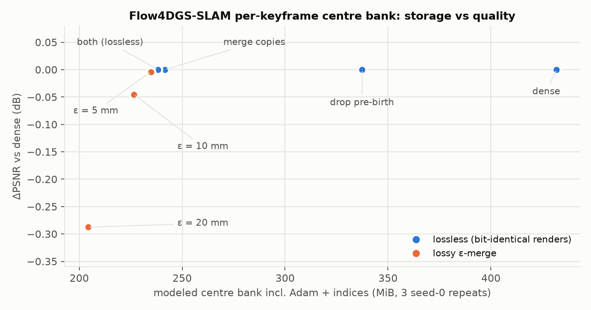

# SAGE-4D: When does removing Gaussians help Gaussian SLAM? — Report

**Summary.** This study links resource profiling to controlled tests of Gaussian reduction. Its clearest
contributions are an execution improvement in Flow4DGS-SLAM, an exact temporal-storage baseline, and evidence
that ranking quality depends on growth versus pruning and on spatial allocation. Trace is useful against weak
pruning baselines, but the tested strong baselines remove its claimed advantage at the adoption margins used here.
The public tables support selected numerical checks and figure generation; independent numerical helpers are also
included. They do not constitute a full rerun package. Dated follow-up results are in [FOLLOW_UP.md](FOLLOW_UP.md).
See the [evidence guide](results/README.md).

## 1. Question and success criteria

**Starting hypothesis.** A per-Gaussian sensitivity signal can shrink Gaussian maps *online*: during 3DGS training
or SLAM mapping, with no post-processing pass, and with little quality loss.

The signal is the mean squared training-loss gradient with respect to a Gaussian's centre and log-scale,
accumulated over the implementation's statistics window. Equivalently, it is the trace of the mean gradient
outer product; below it is called "trace". In Gaussian-SLAM the accumulator resets at each submap optimization
call. It is not a Hessian estimate or a Fisher estimate over the entire mapping history. It needs no additional
scoring renders when accumulated from existing gradients, and its update and selection overheads were later measured separately; see the
[dated cost and implementation follow-up](FOLLOW_UP.md). The original hypothesis below is retained as context.

A useful result needs three links to hold:

1. **N matters.** Fewer Gaussians reduce something that binds: GPU memory, time, or the size of the saved map.
2. **The score matters.** At the same removal budget, trace preserves quality better than simple and strong baselines.
3. **Online is needed.** The reduction has to happen during the run, not afterwards.

**How decisions were made.** Most comparisons are paired (same scene, seed and budget). Decision rules were
recorded in local plans before the corresponding runs wherever this report says **pre-specified**. This is an
author-reported timing statement: the public snapshot does not contain the original protocol/commit history.
Rules chosen after seeing data are labelled **exploratory**. No prospective rule is retroactively applied to an
earlier exploratory result.

## 2. Setup

- **Hardware.** One RTX 5070 Ti (16 GB, sm_120), Windows + WSL2, CUDA 12.8, PyTorch 2.11.
- **Systems.**
  - Static 3DGS: our 3DGS code base, Taming 3DGS and PUP 3D-GS.
  - SLAM: Flow4DGS-SLAM (4D, dynamic scenes), SplaTAM, Gaussian-SLAM and LSG-SLAM.
  - They were run on sm_120, with build or configuration changes where needed (§8).
- **Data.**
  - 3DGS: Mip-NeRF360 kitchen, room and bonsai, plus Tanks & Temples train.
  - SLAM: TUM fr3/walking_xyz, Bonn balloon, Replica (room0, room1, office0) and KITTI 07.
- **Metrics.**
  - Rendering: PSNR, SSIM and LPIPS, on test views for 3DGS and on the system's own evaluation frames for SLAM.
  - Trajectory: ATE as an all-frame RMSE after SE(3) alignment. We corrected two upstream evaluation scripts on this
    point; see §7.
- **Units and replication.** GiB/MiB use powers of 1024. GPU allocated memory, checkpoint bytes (which may include
  optimizer state), and modeled centre-bank storage are distinct measurements. A 35% budget in static 3DGS is a
  retained-count target; 25%/50% in compression experiments are removal targets. Scene–seed pairs are not eight
  independent scenes: seeds within a scene share scene content. Cell-level p-values below are descriptive under
  their stated pairing, not evidence of generalization to new scenes.

## 3. Flow4DGS-SLAM: where the memory goes, and what can be cut exactly

**Porting check** (single-run values near the reported paper results; no statistical equivalence test):

| | ours | paper |
|---|---|---|
| TUM wxyz ATE RMSE | 2.35 cm | 2.5 cm |
| TUM wxyz PSNR | 25.05 dB | 24.60 dB |
| Bonn balloon ATE RMSE | 2.89 cm | 2.6 cm |
| Bonn balloon PSNR | 30.44 dB | 30.30 dB |

Fitting into 16 GB required fixing three memory issues that a 48 GB card hides:
- one RAFT model loaded per frame (about 17 GB on TUM);
- per-frame tensors that nothing reads (about 4.8 GB);
- model copies released only by Python's cyclic garbage collector (out of memory at frame 778).

**Memory profile.**
- Temporal parameters (per-keyframe dynamic centres and GMM) are only 8–12 % of allocated memory.
- Memory grows by about 27 MiB per keyframe, mostly camera data: RGB, normals, flow, depth and masks.

**Lossless storage baselines** (Fig. 2; three repeated seed-0 TUM runs):
- Dropping never-rendered pre-birth slots and merging unchanged copies cuts the per-keyframe centre bank by
  **44.8 %**, with **bit-identical** renders recorded in the original parity checks. The byte model includes
  centre values, Adam moments, and indexing overhead; it is not an observed reduction in runtime VRAM.
  The released tables retain matching rendering metrics and zero alive-centre error, but do not retain the images
  needed to repeat the pixel-level parity check. Online use would need the pre-birth slot used by flow loss and
  copy-on-write handling for merged slots that are optimized again.
- An ε-merge at 5 mm adds little (−0.004 dB). At 20 mm it costs −0.29 dB.

**Keyframe density.** On frames that are a keyframe in no run:
- 1.66× keyframes: +0.44 dB PSNR after refinement (23.19 → 23.63).
- 2× keyframes: 3 of 3 runs ran out of memory.

**Memory engineering** (opt-in; intended to preserve behaviour):
- a model copy without the optimizer state for the frontend;
- release of unread keyframe buffers;
- a fix for a frontend leak.

Three baseline runs at approximately 2× density failed in colour refinement. Three runs with the options
completed at 9.1–9.5 GiB profiled peak allocated memory ([public run summary](results/flow4dgs/memory_options.json)).
They are configuration-level comparisons, not deterministic replays of identical trajectories. At 1×, same-day
quality ranges overlapped; equivalence was not tested. At ≥ 2× quality equivalence is **not** established: two of
the three optimized 2× runs had lower pre-refinement PSNR than all five available off-runs. The additional
2.49× run completed but lost tracking. Thus completion alone does not demonstrate useful higher-density mapping.

**Two leads examined and closed.**

1. **Keyframe placement.**
   - An upstream timing quirk places keyframes in adjacent pairs.
   - Uniform placement at equal keyframe count was ahead in a stopped, preliminary comparison: about +0.4 dB, from
     2 runs against 1.
   - Even a full win would amount to a configuration fix, not a method.
2. **Tracking variance.**
   - The same configuration gives ATE from 2.1 to 6.1 cm.
   - A read-only per-frame tracking log localized the divergence to frontend frames 100–300.
   - Backend keyframe corrections were ruled out: they reduce the error in every run.
   - Observability measures did not predict large tracking errors (AUROC ≤ 0.48). Hitting the iteration cap did
     (0.85).
   - No research mechanism was found within the 4 GPU-hour cap.

## 4. Static 3DGS: what the trace score is good for

**Evaluation correction first.**
- A common "worst-view within −1.5 dB" pass rule fails **36 of 114** directional comparisons between *independent
  vanilla runs*.
- We therefore used an envelope metric calibrated on vanilla-vs-vanilla differences.

**Pruning within one policy** (35 % budget, 4 scenes × 2 seeds):
- Trace beats random by **+0.59 dB** (7/8 cells, exact sign-flip p = 0.016).
- Trace beats an online blend-max score by +0.17 dB (6/8). This does not survive a multiple-comparison correction.

**Budgets and an external baseline** (seed 1, means over 4 scenes; Taming arms run in Taming's faster code base):

| method | PSNR | LPIPS | Gaussians | peak GiB | train min |
|---|---|---|---|---|---|
| vanilla 3DGS (100 %) | 29.35 | 0.186 | 1.27 M | 2.47 | 29.1 |
| trace 35 %, grow then prune | 29.13 | 0.199 | 0.45 M | 2.39 | 24.4 |
| trace 35 %, hard cap from iteration 500 | 28.76 | 0.206 | 0.45 M | **1.16** | 20.8 |
| Taming 3DGS 35 % | 29.57 | 0.204 | 0.44 M | 1.24 | 6.9 |
| Taming growth + trace pruning 35 % | **29.62** | 0.202 | 0.44 M | 1.22 | 7.1 |
| PUP 3D-GS (prune a finished vanilla model, refine 5K) | 29.20 | **0.185** | 0.44 M | (vanilla) | 29.1 + 3.6 |

- Our capped policy halves peak memory but is 0.81 dB behind Taming at a similar measured peak (1.16 vs 1.24 GiB).
- Taming's advantage is budgeted *growth*: a count schedule, with candidates drawn in proportion to a score.

**Separating growth from pruning** (Fig. 3; pre-specified).
- Inside Taming at 35 %, we crossed {Taming score, trace} for growth with {Taming score, trace} for pruning.
- **Trace as the pruning score** helped with either growth score:
  - +0.056 dB with Taming growth (8/8 cells, p = 0.008, all 4 scenes);
  - +0.073 dB with trace growth (5/8 cells).
- **Trace as the growth score** hurt with either pruning score: −0.078 dB and −0.060 dB (1/8 cells each).
- **Controls:**
  - Uniform growth/pruning weights are worse than Taming's score (−0.107 dB, 6/8 cells).
  - The vanilla view-space gradient arm differs from Taming by +0.0005 dB and from trace by +0.0048 dB in mean
    PSNR. Here “trace” means trace for **both growth and pruning**, not the crossed Taming-growth/trace-pruning arm.
    The crossed arm is +0.05565 dB against gradient (4/8 positive pairs), while +0.05614 dB and 8/8 refer to its
    comparison against Taming. These controls change both score roles and do not establish equivalence.
- **Caveat.** The +0.056 dB is below our +0.10 dB adoption bar. The trace-pruned arm also replaced about twice as many
  Gaussians, so this original comparison does not separate ranking from turnover. The later
  [matched-turnover test](FOLLOW_UP.md#1-match-actual-turnover-before-attributing-a-quality-gain) uses an amended
  common growth rule and retains a small effect; it does not retroactively remove this confound.

**Deleting from finished models** (Fig. 4; no fine-tuning, 8 Taming models).
- **At 20 % removal:**
  - Trace loses −0.48 dB, against −1.63 dB for opacity. That is **+1.16 dB, 8/8 cells, p = 0.008**.
  - Against a full-view Taming score the difference is +0.16 dB, with only 4/8 positive pairs: no clear advantage
    is established.
- **At 10 %:** trace has the highest observed mean PSNR among the four count-matched scores, at −0.02 dB.
- **At 30 %:** Taming's render-based score is better (−1.62 against −2.07 dB).
- **Thresholds instead of a count.** A rule "trace < τ × median" did not transfer across scenes within −0.10 dB. A
  plain opacity < 0.01 removed about 9 % at −0.001 dB on these eight models, a near-lossless cleanup in this sample.

## 5. SLAM: is the Gaussian count ever the bottleneck?

- **SplaTAM** (Replica room1, 2000 frames, 640×360).
  - At the end, keyframe images and depth take 1.38 GiB; recorded Gaussian parameters and variable state take 0.12 GiB, for 1.67 M
    Gaussians.
  - Frame time grows over the sequence. A regression attributes about 386 ms per million Gaussians, partly confounded
    with keyframe-selection cost (240 ms at the end).
- **LSG-SLAM** (KITTI 07, front end; the released pipeline maps 50-frame segments as separate maps).
  - One segment peaks at 3.7 GiB.
  - Growing a single map to 201 processed frames (4.05 M Gaussians) peaks at 6.3 GiB.
  - Recomputed ATE RMSE is 16.9 cm over 15 m and 77.9 cm over 261 m without loop closure.
  - [Pocket-SLAM](https://arxiv.org/html/2606.24796v1) reports substantially higher LSG-SLAM memory on KITTI.
    Its workload is not matched to this probe, so these measurements neither reproduce nor contradict its result.
    Loop closure and the back end were not measured here.
- **Gaussian-SLAM** keeps only the current submap on the GPU. Its saved map, however, holds **34 M Gaussians and
  7.69 GiB (8.26 GB) of source checkpoints** for one Replica room. That makes it the natural target for compression.
- **Flow4DGS-SLAM** is dominated by keyframe data (§3).

## 6. Gaussian-SLAM: compressing submaps at closing time

**Setting (offline approximation to a possible submap-closing operation).**
- Every saved submap is pruned with a given score and refined for 50 iterations.
- Results are compared with a refine-only control that receives the same refinement.
- Evaluation renders the mapping cameras (Replica room0, room1 and office0).
- Closed submaps provide a possible integration point, but offline pruning does not establish online equivalence.
  The source trajectory is copied, so identical ATE is true by construction, not evidence of preserved tracking.
  Online dependencies, latency, state updates, and later uses of the submaps still need testing.

**Global ranking fails** (pre-specified screen, before the colour-freeze correction in §7).
- Pruning the lowest-trace Gaussians per submap was worse than random at 25 / 50 / 75 %.
- In a diagnostic sample (room0, submap 10), 50% global pruning empties 10.3% of 5 cm voxels; random empties 2.9%.
- The low-trace group has high median opacity (0.91). Together with the emptied voxels, this is consistent with
  deleting converged surfaces; it is a diagnosis, not an independently established causal mechanism. Comparisons
  between pruned arms share the colour-refinement confound; their losses against refine-only are not clean
  compression losses. The corrected results below are the quantitative basis for the main compression claim.

**Ranking within voxels works** (exploratory rule, then pre-specified confirmation on two more scenes; Fig. 5).
- Each occupied 5 cm voxel loses `floor(removal_share × count)` Gaussians, lowest score first. At a nominal 25%,
  realized removal is 23.96% / 24.58% / 24.53% for room0 / office0 / room1. Colours are frozen in every arm.
- At ~25 % removal:

| scene | trace | contribution ΣTα | opacity | random (per voxel) | random (same total) |
|---|---|---|---|---|---|
| room0 | **−0.22** | −0.23 | −0.89 | −1.42 | −1.56 |
| office0 | **−0.19** | −0.19 | −1.00 | −0.86 | −0.90 |
| room1 | −0.27 | **−0.22** | −1.31 | −1.40 | −1.50 |

Values are ΔPSNR (dB) against refine-only. Room0 checkpoints shrink from 4.939 to 3.755 GiB (24.0%), including
optimizer state, relative to the equally re-saved/refined control. The public storage summary retains these
rounded measurements; it does not provide exact checkpoint-byte records for all three scenes.

- Stratification alone adds only +0.04 to +0.14 dB to random. The gain comes from the ranking inside each voxel.
- Trace and the blending contribution ΣTα differ by less than 0.05 dB in observed PSNR. The per-view maximum
  contribution control (`contribmax_voxel`, also shown in Fig. 5) is within 0.06 dB. Neither establishes trace
  superiority, and similar observed values do not establish equivalence.
  - Trace has slightly better LPIPS in all three scenes.
  - The contribution score has slightly lower depth error in two.

**Pushing further** (pre-specified; all failed their rules).
- **50 % removal.** −1.2 to −2.5 dB with 50 refinement iterations. With 500 iterations, trace still loses −0.60 dB.
  At 50 %, contribution beats trace by 0.6–1.0 dB.
- **Capping the densest voxels first** (water-filling), instead of an equal share per voxel: −1 to −13 dB. Dense voxels
  are not redundant ones.
- **A hybrid rank** (mean of the trace and contribution percentiles): ahead of the best single score by only
  +0.03–0.04 dB at 25 %. It has the best LPIPS at 50 %.

**Relation to prior work.** [Pocket-SLAM (2026)](https://arxiv.org/html/2606.24796v1) uses rendering-area scores
and image-tile budgets for online pruning. Our contribution control uses ΣTα and 3D voxel quotas in an offline
experiment. The spatial-coverage observation is consistent with that work, but this is neither a reproduction of
Pocket-SLAM nor a comparison against its full method. The trace/contribution agreement is limited to the tested
low-removal setting; they diverge at higher removal.

## 7. Corrections made during the study and release review

Each of these was found by a check or review. Corrected comparisons are used above; historical confounded rows
remain in the JSON and are explicitly excluded from the main analyses.

- **Release baseline arithmetic.** The seed-1 table gives 29.570231 − 28.764565 ≈ 0.806 dB for Taming versus the hard-cap
  policy. The earlier 0.76 dB wording did not match this table; the comparison now reports 0.81 dB.
- **Release memory units.** The original draft reported 9.3–9.8 GiB for the optimized 2× runs. Direct extraction
  from the retained profiler byte records gives 9.11–9.53 GiB, now used here. This is profiler allocated memory,
  not total device memory. The release also renames historical Flow4DGS `ate_cm` to `ate_mean_cm` and represents
  unavailable/OOM metrics as JSON `null`; those old ATE values are not RMSE.

- **Flow4DGS's `ATE_0.json`.** It stores a mean error, not an RMSE. Corrected RMSE and retained historical
  `ate_mean_cm` fields are explicitly distinguished; mean errors in the public historical tables were not converted.
- **LSG-SLAM's printed "ATE RMSE".** It is a mean, computed on world-to-camera translations instead of camera
  centres. We recomputed it, and withdrew an earlier claim that long single maps "collapse".
- **Gaussian-SLAM pruning tool.** Re-creating the parameters re-enabled colour learning in pruned arms only. After the
  fix:
  - the 25 % loss went from −0.095 to −0.216 dB;
  - checkpoint savings went from 12 % to 24 % (optimizer state for colours is no longer saved).
- **Post-hoc Taming score.** It was first computed on 10 sampled views, so Gaussians unseen in those views scored zero.
  It was recomputed on all training views; this amendment is documented.
- **Early 3DGS summary.** A count of 7/34 gate failures was wrong; the correct count is 36/114.
- **Two arithmetic and wording errors** in intermediate notes:
  - "+0.72 dB" should have been +1.20 dB;
  - a depth advantage held in 2 of 3 scenes, not 3 of 3.

## 8. Reproducibility

- **Available now.** `scripts/summarize_results.py` recomputes selected headline comparisons, and
  `scripts/make_figures.py` regenerates the original five figures on a CPU.
  Follow-up summary/figure commands and a standalone CPU example are listed in [README.md](README.md). The [data guide](results/README.md) maps claims
  to files and records exclusions and gaps. These are curated metric tables, not raw experiment outputs.
  The original figure check used Python 3.10.20, NumPy 2.2.6 and Matplotlib 3.10.9.
  The current full public-package check records its separate versions in [release verification](results/release_verification.json).
- **Full reruns are not supported by this release alone.** The upstream commits below identify starting points,
  not complete experiment versions. Local changes, configurations, evaluation splits, and environment details
  would also be needed:

| system | upstream | our changes |
|---|---|---|
| Flow4DGS-SLAM (wangys16/Flow4DGS-SLAM) | `ecb4e94` | sm_120 / WSL port; opt-in profiling, memory options, tracking log |
| Taming 3DGS (humansensinglab/taming-3dgs) | `fd0f7d9` | one-line `<cfloat>` build fix; opt-in score modes; pruning-weight alignment after split |
| PUP 3D-GS (j-alex-hanson/gaussian-splatting-pup) | `e971ea4` | CUDA 12.8 build fixes |
| SplaTAM (spla-tam/SplaTAM) | `da6bbcd` | read-only per-frame memory/time profile |
| Gaussian-SLAM (VladimirYugay/Gaussian-SLAM) | `eaec10d` | passive trace statistics in checkpoints; offline voxel-stratified pruning tool |
| LSG-SLAM (lsg-slam/LSG-SLAM) | `2b8cfdb` | KITTI 07 config; parser paths |

- **Not included.** Local patches and the complete experiment harness are not redistributed in this release.
  Some affected files have non-commercial or unclear terms; patch sharing requires a file-level review. A
  non-commercial license alone does not imply a blanket redistribution ban. See [THIRD_PARTY.md](THIRD_PARTY.md).
- **Preservation limits.** Some large checkpoints and renders were deleted after extraction. Published aggregates
  can be recomputed only to the resolution retained in these tables. Re-rendering, pixel-level parity checks,
  per-view uncertainty estimates, and parts of the original diagnostics require additional artifacts or new runs.
- **Protocol history.** Pre-specified decision rules are described in the text, but the original plans and their
  dated commit history are not bundled here. They should be released in a sanitized form before claiming that
  readers can independently audit pre-specification.

## 9. Limitations

- Mostly single-seed original SLAM experiments on a few indoor scenes and one KITTI sequence;
  cost/implementation follow-ups add three paired seeds on two short GT-pose prefixes. Differences of a few hundredths
  of a dB are not established; ties are not proofs of equivalence.
- Gaussian-SLAM compression is offline and evaluated on mapping views. Online pruning during mapping, held-out views
  and the effect on tracking were not tested.
- For LSG-SLAM only the front end was profiled.
- The Gaussian-SLAM voxel rule was chosen after a failed screen; later rules were fixed before their individual
  runs, as recorded in local notes. The confirmation uses two additional scenes, not an independent broad benchmark.
- Several cross-code-base time comparisons (our 3DGS code against Taming) mix method and implementation speed.

## 10. Takeaways and follow-up status

**What the evidence supports.** Profile the resource before optimizing Gaussian count. Use exact redundancy removal
as a storage baseline, test growth and deletion scores separately, and compare rankings under matched spatial
quotas. In these experiments, low-removal trace pruning is competitive with contribution scoring; high-removal
results favour contribution. The combination of useful engineering changes, fair controls, and documented
corrections is the contribution of this report.

**Completed follow-ups.** The matched-turnover comparison, a fixed soft-trace candidate with gradient/random
controls, a phase-specific cost experiment, and same-result implementation optimization are reported separately
in [FOLLOW_UP.md](FOLLOW_UP.md). They extend this report rather than replacing its original benchmarks.
The exact deletion-count controls and the stronger gradient comparison did not establish the intended trace
quality advantage. Score collection needs no extra rendering pass, but that alone does not establish lower total
cost. The implementation follow-up tests the cost of preserving the same score and selection results.

**Next work is conditional.** An online closing prototype would need a workload where measured compression latency
or map storage actually constrains the application. Use the strongest optimized contribution baseline, retain
matching refinement work, and reserve genuinely held-out views before mapping/scoring/refinement. Measure tracking,
relocalization, closing latency, total runtime and peak VRAM independently. Copied source poses cannot validate
tracking preservation. No such online integration or held-out evaluation has been completed here.

The release is closed at this bounded scope. Further parameter sweeps or heavier pruning are not justified by
these results alone. Future experiments should start from a concrete resource bottleneck and a fixed compute cap.
