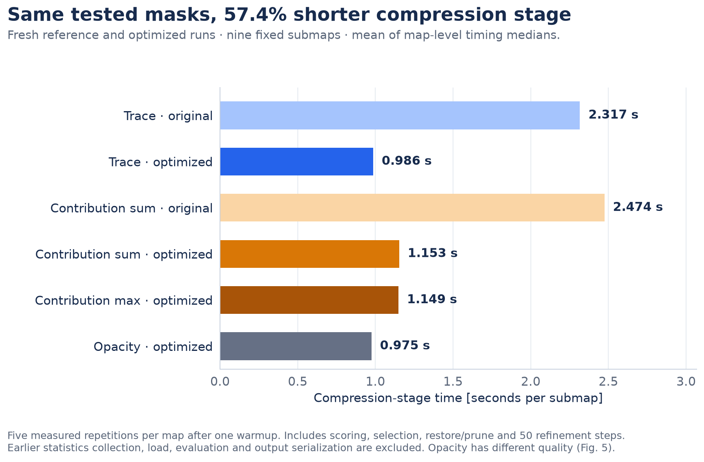
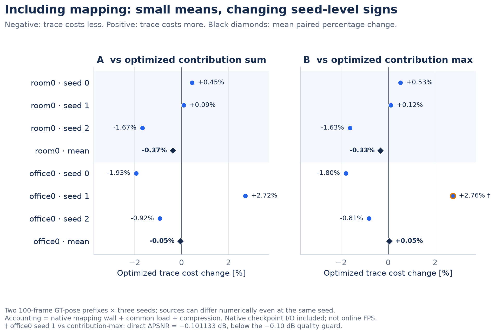

# 연구 흐름과 결과 요약

[영문 본문 보고서](REPORT.md) · [상세 비교표](FOLLOW_UP.md) · [그래프와 SVG](figures/README.md)

이 연구는 **학습에서 이미 계산한 gradient를 점수로 재사용하면 Gaussian 지도를 저렴하게 줄일 수 있는가**에서
출발했습니다. 병목 분석과 강한 대조군 실험을 거치며, 점수 자체의 일반적인 우위와 구현 개선 성과를 구분했습니다.

## 1. 먼저 무엇이 병목인지 확인했습니다

Gaussian 수, keyframe 데이터, 저장된 지도 파일은 서로 다른 자원입니다. 측정한 SplaTAM 사례에서는 마지막
keyframe RGB/depth가 1.38 GiB인 반면 Gaussian 파라미터와 기록된 상태는 0.12 GiB였습니다. Flow4DGS에서는
불필요한 버퍼·optimizer 복사·누수를 정리해 약 2배 keyframe 설정에서 3회 모두 완료했지만, 이 밀도에서 품질
동등성은 확인하지 못했습니다. LSG-SLAM은 frontend만 측정했습니다.

**다음 판단:** Gaussian 개수만 줄여 모든 메모리 문제를 해결한다고 가정하지 않고, 저장된 submap 압축을 별도 목표로 삼았습니다.

## 2. 점수 효과와 교체량 효과를 분리했습니다

초기 Taming 성장 + trace 삭제의 +0.056 dB에는 약 1.8배의 실제 교체량 증가가 섞여 있었습니다. 삭제 수까지
맞춘 두 장면·두 seed 비교에서는 **+0.074 dB**가 남았지만 사전에 정한 +0.10 dB 기준에는 미달했습니다.
이 비교에는 공통 성장 규칙 보완이 들어갔으므로 초기 향상의 원인을 완전히 규명한 결과는 아닙니다.

작은 이득도 허용한 후속 seed-3 실험에서는 soft trace가 기존 trace보다 +0.074 dB 좋아졌지만,
**gradient 삭제 대조군보다 약 0.104 dB 낮았습니다.** 두 trace 후보 모두 확대 기준에 미달해 다음 seed는 실행하지 않았습니다.

**다음 판단:** 점수의 품질 우위 주장은 제한하고, SLAM에서는 같은 공간 quota 아래 품질과 비용을 별도로 비교했습니다.

## 3. 공간을 보존한 압축은 낮은 제거율에서 의미가 있었습니다

5 cm voxel마다 같은 비율을 삭제하고 정제 횟수와 색상 동결을 맞췄습니다. 세 Replica 장면에서 실제 Gaussian
제거율은 **24.0–24.6%**, refine-only 대비 PSNR 손실은 **0.19–0.27 dB**였습니다. room0의 공정한 checkpoint
비교에서는 **4.939 → 3.755 GiB, 약 24%** 줄었습니다. 다만 contribution-sum/max도 PSNR 차이 0.06 dB 이내였고,
약 50% 제거에서는 contribution이 더 좋았습니다. 평가에는 mapping view와 고정된 원본 pose를 사용했습니다.

**다음 판단:** 오프라인 저장 용량과 품질의 절충은 관측됐지만, 추적 정확도·새 시점 품질·온라인 속도 향상은 별도 검증이 필요합니다.

## 4. 압축 단계와 통계 수집을 포함한 비용은 달랐습니다

초기 비용 실험에서 이미 통계가 있을 때 trace 압축은 contribution보다 약 8% 빨랐습니다. 그러나 통계 수집과
mapping을 포함하면 이득이 확인되지 않았습니다. 단계별 시간을 보니 voxel 선택이 큰 비중을 차지했습니다.

**다음 판단:** 점수 공식을 바꾸기보다, 같은 통계와 같은 삭제 mask를 더 효율적으로 계산하도록 구현을 개선했습니다.

## 5. 구현은 빨라졌지만 전체 비용의 안정적인 우위는 남은 문제입니다

9개 고정 submap에서 압축 단계 시간은 **2.32초 → 0.99초, 57.4% 단축**됐습니다. 각 submap의 5회 측정
중앙값을 평균한 수치이며, 이전 통계 수집·공통 로딩·평가·출력 저장은 제외합니다. 같은 입력의 삭제 mask
**264건이 원 구현과 일치**했습니다. contribution에도 같은 선택 최적화를 적용한 뒤 비교해도 압축 단계는 약 14.5% 빨랐습니다.

*압축 단계의 비교입니다. 통계 수집 이전 비용까지 포함한 전체 SLAM 속도 향상률이 아닙니다.*

통계 수집을 포함한 새 mapping+압축 비교에서는 contribution-sum 대비 장면 평균이
**room0 -0.37%, office0 -0.05%**였습니다.
6개 장면–seed 쌍 중 3개만 더 빨랐고 부호가 바뀌었습니다. 따라서 안정적인 전체 비용 우위로 해석하지 않았습니다.
또한 office0 seed 1의 contribution-max 직접 품질 비교는 PSNR −0.101133 dB로 −0.10 dB 기준에 조금 미달했으며,
이를 실패로 남겼습니다. 같은 고정 source의 12개 품질 비교는 모두 기준 안에 있었습니다.

*음수는 trace가 더 저렴함을 뜻합니다. 점은 개별 seed, 검은 마름모는 장면 평균입니다. 작은 평균만 보지 않고 seed별 변동을 함께 확인합니다.*

현재 성과는 **병목 분석, 통제된 점수 비교, 검증된 압축 구현 개선**입니다. 온라인 SLAM FPS나 tracking 보존,
전체 GPU 메모리 절감, trace의 일반적인 품질 우위로 확대하지 않습니다. 이번 수정에서는 새 GPU 실험을 추가하지
않고 같은 숫자로 연구 흐름·비교 기준·그래프 가독성을 정리했습니다.
